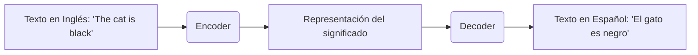

# Conceptos: Traducción con Inteligencia Artificial

¡Hola! En esta sección vamos a sumergirnos en el mundo de la **Traducción Automática** usando Inteligencia Artificial. Hasta ahora, nuestro juego de preguntas tiene un pequeño detalle: las preguntas están en inglés. Como queremos que nuestra audiencia de habla hispana lo disfrute, vamos a usar modelos de IA para traducir todo a español de forma automática.

---

## 1. ¿Qué es la Traducción Automática?

La Traducción Automática (Machine Translation, en inglés) es el uso de software para traducir texto o voz de un idioma a otro. La historia de cómo hacemos esto ha evolucionado muchísimo:

*   **Basada en reglas (Los inicios):** Antes, los programadores escribían diccionarios enormes y reglas gramaticales complejas a mano. (Por ejemplo: "Si ves la palabra 'dog', traducila a 'perro'"). Era un proceso lento y las traducciones sonaban muy robóticas.
*   **Estadística (Los 2000s):** Luego, empezamos a usar matemáticas. Los sistemas analizaban millones de textos ya traducidos (como documentos de la ONU) y calculaban probabilidades. (Por ejemplo: "'dog' suele traducirse como 'perro' el 95% de las veces"). Mejoró mucho, pero aún fallaba en oraciones largas.
*   **Neuronal (Hoy en día):** Acá es donde brilla la Inteligencia Artificial. Usamos **Redes Neuronales Artificiales** (programas inspirados en el cerebro humano) para entender el contexto completo de una oración antes de traducirla.

---

## 2. Modelos de Traducción Neuronal (NMT)

Los modelos de traducción actuales usan una arquitectura llamada **Encoder-Decoder** (Codificador-Decodificador). Suena complejo, pero es como funciona el cerebro de un traductor humano:

1.  **El Encoder (El que lee):** El modelo lee la oración original completa. En lugar de traducir palabra por palabra, crea una "representación interna" o un "resumen matemático" de lo que significa la oración.
2.  **El Decoder (El que habla):** Toma ese resumen interno y empieza a generar la traducción en el nuevo idioma, palabra por palabra, recordando siempre de qué se trata el texto completo.



---

## 3. Hugging Face y Helsinki-NLP

Para nuestro proyecto, no vamos a crear un modelo desde cero (¡tomaría meses y computadoras carísimas!). Vamos a descargar uno que ya está entrenado, gracias a **Hugging Face**, que es como un "GitHub" pero para modelos de IA.

Usaremos un modelo creado por el grupo de investigación **Helsinki-NLP**. Ellos crearon la familia de modelos **MarianMT**, que son geniales por varias razones:
*   Son **gratis** y de código abierto.
*   Funcionan **offline** (no tenés que pagarle a Google o a OpenAI por cada palabra que traducís).
*   Tienen muy buena calidad.
*   ¡Tienen modelos para casi cualquier par de idiomas!

La convención para nombrarlos es: `Helsinki-NLP/opus-mt-{origen}-{destino}`.
Como nosotros queremos traducir del Inglés (en) al Español (es), vamos a usar el modelo: `Helsinki-NLP/opus-mt-en-es`.

---

## 4. Tokenización

Antes de que el modelo pueda leer texto, tenemos que convertir las palabras a números, porque la IA solo entiende matemáticas. Este proceso se llama **Tokenización**.

El modelo rompe el texto en pedacitos llamados **tokens**. A veces, un token es una palabra entera, pero otras veces, si la palabra es rara o larga, la rompe en sílabas o partes. 

Se usa un método llamado **BPE (Byte Pair Encoding)**.
*   Por ejemplo, la palabra "cat" podría ser un solo token: `[cat]`
*   Pero una palabra compleja como "overfitting" podría romperse así: `['over', 'fit', 'ting']`

Esto es súper útil porque le permite al modelo entender palabras que nunca antes había visto, juntando pedacitos que sí conoce.

---

## 5. Beam Search y Generación de Texto

¿Cómo elige el modelo qué palabra decir a continuación? No elige simplemente la palabra "más probable" y sigue adelante, porque podría meterse en un callejón sin salida gramatical.

Usa una técnica llamada **Beam Search** (Búsqueda en Haz).
Imaginate que estás usando el GPS para ir a un lugar. El GPS no calcula solo la primera calle y dobla. Calcula varias rutas posibles completas y al final te muestra la que toma menos tiempo.

El modelo hace lo mismo: explora múltiples "caminos" o posibles traducciones al mismo tiempo, y al final elige la oración completa que tiene más sentido en español.

---

## 6. Calidad de Traducción

¿Cómo sabemos si una traducción es buena? En el mundo de la IA, usamos métricas como el **BLEU score** (Bilingual Evaluation Understudy). Básicamente, compara la traducción de la máquina con una traducción hecha por un humano. Cuanto más se parezcan, mayor es el puntaje.

**Problemas comunes a los que tenés que estar atento:**
*   **Traducciones literales:** Expresiones como "It's raining cats and dogs" podrían traducirse como "Están lloviendo gatos y perros" (cuando debería ser "Llueve a cántaros").
*   **Pérdida de contexto:** Palabras con múltiples significados (como "bat", murciélago o bate).
*   **Términos técnicos:** Nombres de librerías de código o tecnologías que no deberían traducirse.

Para nuestro juego de preguntas, la IA actual es "suficientemente buena" para el 99% de los casos.

---

## 7. Traducción por Lotes (Batch)

Imaginate que tenés 10,000 preguntas en tu base de datos. Si le mandás una pregunta a la IA, esperás que la traduzca, luego la segunda, luego la tercera... ¡vas a tardar muchísimo!

La solución es la **Traducción por Lotes (Batching)**.
En lugar de mandar las oraciones de a una, le mandamos a la IA un paquete de 32 o 64 oraciones al mismo tiempo. Como los procesadores modernos (y especialmente las Tarjetas Gráficas o GPUs) son excelentes haciendo matemáticas en paralelo, van a traducir esas 32 oraciones casi en el mismo tiempo que les tomaría traducir una sola.

---

## 8. El Pipeline de Hugging Face

Usar todo esto en código es sorprendentemente fácil. La librería `transformers` de Hugging Face tiene una herramienta llamada `pipeline` que oculta toda la complejidad (descargar el modelo, inicializar el tokenizer, etc.).

Te muestro cómo se ve un ejemplo simple (¡lo veremos en detalle en el ejercicio!):

```python
from transformers import pipeline

# 1. Cargamos el modelo
traductor = pipeline('translation', model='Helsinki-NLP/opus-mt-en-es')

# 2. Le pasamos un texto
resultado = traductor("What is the capital of France?")

# 3. Vemos el resultado
print(resultado[0]['translation_text'])
# Imprime: "¿Cuál es la capital de Francia?"
```

---

## 9. Post-procesamiento

La IA es buena, pero a veces necesita un empujoncito. El **post-procesamiento** es cuando escribimos reglas en código para "limpiar" la traducción que nos dio la IA.

Por ejemplo, en inglés las preguntas empiezan con un signo de interrogación al final (`?`), pero en español deberíamos poner uno al principio (`¿`). A veces el modelo de IA se olvida de poner el `¿`. Nosotros podemos escribir una pequeña función en Python que diga: "Si el texto traducido termina en `?` y no empieza con `¿`, agregale el `¿` al principio".

---

## 10. Consideraciones para nuestro proyecto

En nuestro caso práctico, las preguntas de trivia originales están en inglés. Para adaptar el juego al español, tenemos que:
1.  Tomar cada pregunta y su respuesta correspondiente.
2.  Traducir **ambas** al español.
3.  **Guardar ambas versiones en la base de datos**. No queremos borrar el inglés original, porque tal vez en el futuro querramos ofrecer el juego en ambos idiomas.
4.  Crearemos nuevas columnas en nuestra base de datos para `question_es` (pregunta en español) y `answer_es` (respuesta en español).

¡Con estos conceptos claros, ya estás listo para pasar al código y enseñarle español a nuestro backend!

---

### Recursos para practicar
*   Buscá en la web "Hugging Face Models" e investigá la familia `Helsinki-NLP`. ¡Vas a ver que hay cientos de idiomas disponibles!
*   Podés probar el modelo `opus-mt-en-es` directamente desde el navegador en la página web de Hugging Face antes de escribir una línea de código.
