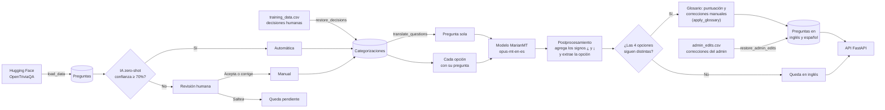
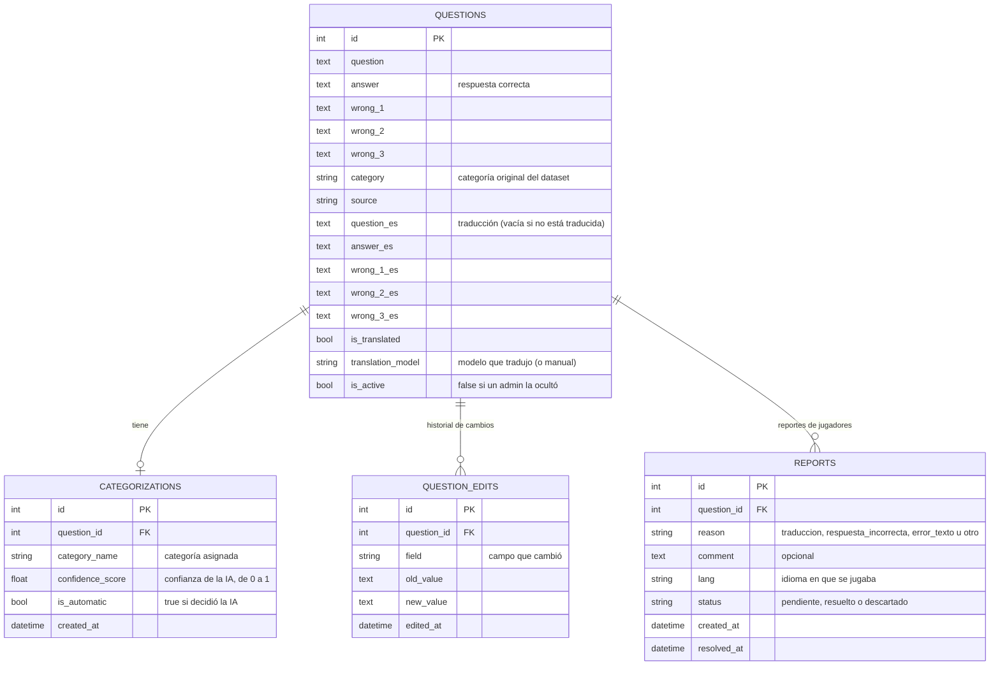
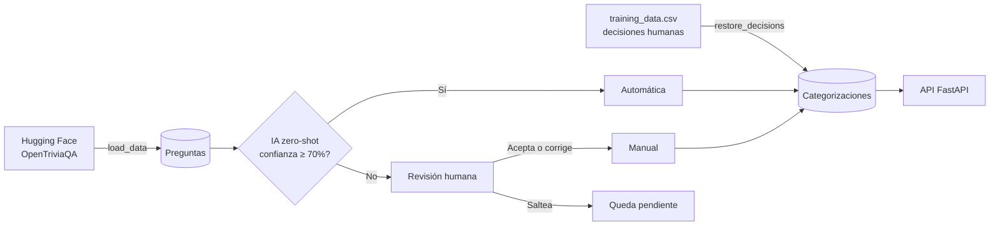
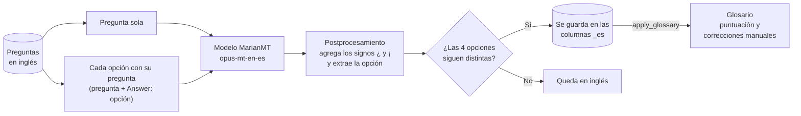

# Questions API — Trivia estilo Preguntados con categorización y traducción por IA


API de preguntas de trivia estilo *Preguntados*, construida con **FastAPI**, **SQLAlchemy** y **PostgreSQL**. Las preguntas se cargan desde un dataset de Hugging Face, se categorizan con un modelo de IA (*zero-shot classification*), con **revisión humana** (*Human-in-the-Loop*) para los casos en que la IA no está segura, y se **traducen al español** con un modelo de traducción automática. Se puede jugar en español o en inglés.

El juego se juega desde un **frontend web** hecho con **React, Vite y TypeScript** (`frontend/`): dos personas en el mismo dispositivo, por turnos. Ver [Frontend (juego web)](#frontend-juego-web).

Proyecto de Práctica Profesional II — CDIA.

## Índice

1. [Visión general](#visión-general)
2. [Tecnologías](#tecnologías)
3. [Estructura del proyecto](#estructura-del-proyecto)
4. [Base de datos](#base-de-datos)
5. [Requisitos](#requisitos)
6. [Instalación y puesta en marcha](#instalación-y-puesta-en-marcha)
7. [Uso de GPU (opcional)](#uso-de-gpu-opcional)
8. [API](#api)
9. [Frontend (juego web)](#frontend-juego-web)
10. [Dataset](#dataset)
11. [Categorización con IA](#categorización-con-ia)
12. [Traducción con IA](#traducción-con-ia)
13. [Scripts](#scripts)
14. [Resultados](#resultados)
15. [Tests](#tests)
16. [Seguridad](#seguridad)
17. [Problemas frecuentes](#problemas-frecuentes)
18. [Limitaciones conocidas y posibles mejoras](#limitaciones-conocidas-y-posibles-mejoras)
19. [Créditos y licencias](#créditos-y-licencias)

---

## Visión general

Flujo completo del backend: las preguntas se cargan, se categorizan con IA (con revisión humana cuando la IA no está segura), se traducen al español y quedan disponibles en la API.



1. **Carga** (`load_data`): descarga el dataset en una versión fija, verifica que el archivo sea el esperado, repara la codificación, se queda con las preguntas de 4 opciones y elimina duplicados. Ver [Dataset](#dataset).
2. **Decisiones humanas** (`restore_decisions`): recupera las categorizaciones que revisó una persona, guardadas en el repositorio. Las nuevas se exportan con `export_training`.
3. **Categorización** (`categorize`): la IA asigna una de las 6 categorías. Si está segura (≥ 70%), se guarda sola; si no, decide una persona o la pregunta queda pendiente. Ver [Categorización con IA](#categorización-con-ia).
4. **Traducción** (`translate_questions` y `apply_glossary`): la IA traduce cada pregunta y sus opciones al español, sin tocar el inglés, y después se aplica un glosario de correcciones. Ver [Traducción con IA](#traducción-con-ia).
5. **Correcciones del admin** (`restore_admin_edits`): vuelve a aplicar lo que un admin corrigió desde la API, guardado en el repositorio. Va al final, así gana sobre lo automático. Las nuevas se exportan con `export_admin_edits`. Ver [Guardar las correcciones del admin](#guardar-las-correcciones-del-admin).
6. **API**: el juego entrega preguntas categorizadas, en el idioma pedido y sin revelar la respuesta hasta que el jugador elige. Ver [API](#api).
7. **Frontend**: el juego web pide las preguntas a la API, muestra las 4 opciones y deja que la API decida si la respuesta es correcta. Ver [Frontend (juego web)](#frontend-juego-web).

## Tecnologías

| Área | Herramientas |
|---|---|
| Lenguaje y dependencias | Python 3.13, Poetry |
| API | FastAPI, Uvicorn |
| Base de datos | PostgreSQL (en Docker), SQLAlchemy |
| Datos | pandas, pyarrow, requests, ftfy |
| IA | transformers, PyTorch, sentence-transformers, scikit-learn, SetFit |
| Traducción | transformers (MarianMT), sentencepiece, sacremoses |
| Tests | pytest, httpx |
| Frontend | React 19, Vite 8, TypeScript 6 (modo estricto), React Router 7, CSS con variables, fuente Baloo 2 (OFL) |
| Tests del frontend | Vitest, React Testing Library, jsdom, cobertura con v8 |

## Estructura del proyecto

```
├── app/
│   ├── __init__.py
│   ├── main.py                     # Endpoints de la API
│   ├── schemas.py                  # Validación de los datos que recibe la API (Pydantic)
│   ├── database.py                 # Conexión a PostgreSQL y sesión
│   ├── models.py                   # Tablas: questions (con traducción), categorizations, question_edits y reports
│   ├── load_data.py                # Descarga, limpia y carga el dataset
│   ├── categories.py               # Las 6 categorías y sus descripciones
│   ├── classifier.py               # Clasificador zero-shot (IA)
│   ├── model_versions.py           # Versiones fijas (commits) de los modelos de IA
│   ├── cosine_classifier.py        # Clasificador alternativo: similitud coseno
│   ├── human_review.py             # Revisión humana por consola
│   ├── categorize.py               # Orquestador: IA + revisión humana
│   ├── review_automatic.py         # Medición de precisión con revisión humana
│   ├── export_training.py          # Exporta las decisiones humanas a CSV
│   ├── restore_decisions.py        # Restaura las decisiones humanas desde el CSV
│   ├── evaluate.py                 # Banco de pruebas para comparar configuraciones
│   ├── train_classifier.py         # Experimento: clasificador entrenado (pseudo-etiquetado)
│   ├── train_setfit.py             # Fine-tuning con SetFit
│   ├── translator.py               # Traductor inglés -> español (IA)
│   ├── translate_questions.py      # Traducción masiva de las preguntas
│   ├── verify_lang.py              # Muestra preguntas en inglés y español
│   ├── review_translations.py      # Medición de la calidad de la traducción con revisión humana
│   ├── glossary.py                 # Glosario: regla de puntuación y correcciones manuales
│   ├── apply_glossary.py           # Aplica el glosario a las traducciones de la base
│   ├── admin_edits.py              # Correcciones del admin: resumir, validar y guardar en CSV
│   ├── export_admin_edits.py       # Exporta las correcciones del admin a CSV
│   ├── restore_admin_edits.py      # Vuelve a aplicar las correcciones del admin desde el CSV
│   ├── rate_limit.py               # Límite de pedidos por IP (reportes)
│   └── fix_encoding.py             # Reparación de codificación (ya integrada en load_data)
├── data/
│   ├── training_data.csv           # Decisiones humanas (ejemplos verificados)
│   ├── precision_review.csv        # Registro de la revisión de precisión
│   ├── translation_review.csv      # Registro de la revisión de las traducciones
│   ├── translation_corrections.csv # Correcciones manuales de la traducción (glosario)
│   └── admin_edits.csv             # Correcciones hechas por un admin desde la API
├── tests/
│   ├── conftest.py                 # Marcadores por carpeta, base de prueba y cliente de la API
│   ├── unit/
│   │   ├── test_admin_edits.py
│   │   ├── test_categories.py
│   │   ├── test_classifier.py
│   │   ├── test_glossary.py
│   │   ├── test_human_review.py
│   │   ├── test_load_data.py
│   │   ├── test_review_translations.py
│   │   ├── test_model_versions.py
│   │   ├── test_rate_limit.py
│   │   ├── test_statistics.py
│   │   └── test_translator.py
│   ├── integration/
│   │   ├── test_admin_edits_scripts.py
│   │   ├── test_api.py
│   │   ├── test_apply_glossary.py
│   │   ├── test_game.py
│   │   ├── test_question_admin.py
│   │   ├── test_reports.py
│   │   ├── test_restore_decisions.py
│   │   └── test_translation_columns.py
│   ├── data_quality/
│   │   ├── conftest.py             # Conexión a la base real (saltea si no está disponible)
│   │   ├── test_admin_edits.py
│   │   ├── test_categorizations.py
│   │   ├── test_csv_files.py
│   │   ├── test_questions.py
│   │   └── test_translations.py
│   └── validation/
│       ├── test_api_auth.py
│       ├── test_api_inputs.py
│       ├── test_api_robustness.py
│       ├── test_cors.py
│       └── test_model_quality.py
├── frontend/                       # Juego web (React + Vite + TypeScript), ver Frontend (juego web)
│   ├── src/api/                    # Único lugar que llama a la API: valida cada respuesta
│   ├── src/game/                   # Reglas del juego en TypeScript puro (sin interfaz)
│   ├── src/components/             # Pantallas: lobby, ruleta, pregunta, resultado, cambio de turno, fin de partida
│   ├── src/styles/                 # Estilos y variables de diseño (tokens.css)
│   ├── public/fonts/               # Fuente Baloo 2 (licencia OFL) incluida en el proyecto
│   ├── package.json                # Dependencias y comandos (npm)
│   └── .env.example                # Dirección de la API (VITE_API_URL)
├── .vscode/settings.json           # Configura VS Code para usar Poetry
├── prueba_clasificador.py          # Prueba rápida del clasificador
├── prueba_traduccion.py            # Prueba rápida de la API en español e inglés
├── docker-compose.yml              # Servicio de PostgreSQL
├── .env.example                    # Plantilla de credenciales (copiar como .env)
├── pyproject.toml                  # Dependencias y configuración de pytest
├── poetry.lock                     # Versiones exactas de las dependencias
├── EXERCISE.md                     # Consigna del ejercicio base
├── CONCEPTS.md                     # Conceptos del ejercicio base
├── EXERCISE_AI_CATEGORIZATION.md   # Consigna de la categorización con IA
├── CONCEPTS_AI_CATEGORIZATION.md   # Conceptos de la categorización con IA
├── EXERCISE_AI_TRANSLATION.md      # Consigna de la traducción con IA
├── CONCEPTS_AI_TRANSLATION.md      # Conceptos de la traducción con IA
├── EXERCISE_AI_UIUX.md             # Consigna de la interfaz
├── CONCEPTS_AI_UIUX.md             # Conceptos de la interfaz
└── FIRST_STEPS.md                  # Instrucciones de la cátedra para traer cada consigna
```

Cada carpeta de `tests/` tiene además un `__init__.py` vacío. En `frontend/`, las carpetas `node_modules/`, `dist/` y `coverage/` se generan al instalar, compilar y medir la cobertura, y tampoco se suben. Las carpetas `models/` (modelos entrenados) y `checkpoints/` se generan al entrenar y no se suben al repositorio, igual que el archivo `.env` (credenciales), los entornos virtuales y la caché de Python (ver `.gitignore`).

## Base de datos

Cuatro tablas: las preguntas del dataset (en inglés y su traducción al español), la categoría asignada a cada una, el historial de cambios que hace un admin y los reportes de los jugadores. Cada pregunta tiene como máximo una categorización.



La categoría original del dataset (`questions.category`) se conserva aparte de la asignada (`categorizations.category_name`), para poder compararlas. Del mismo modo, la traducción se guarda en columnas aparte (`_es`) y el inglés original nunca se modifica automáticamente: solo lo puede cambiar un admin, y cada cambio queda en `question_edits` con el valor anterior. Las preguntas no se borran: un admin puede ocultarlas (`is_active = false`) y volver a mostrarlas.

Las columnas y tablas nuevas se agregan solas a una base creada antes: `create_all()` crea las tablas que faltan y `ensure_question_columns()` (en `app/models.py`) agrega las columnas. Las dos se ejecutan al arrancar la API, en `load_data` y en `translate_questions`.

## Requisitos

- **Python 3.11 a 3.13**
- **[Poetry](https://python-poetry.org/)** para el manejo de dependencias
- **[Docker](https://www.docker.com/)** para la base de datos
- **[Node.js](https://nodejs.org/) 22 LTS o más nuevo** para el frontend (por ejemplo, 24 LTS)
- **Opcional:** GPU NVIDIA para acelerar la IA. Sin GPU todo funciona igual, pero la categorización completa pasa de ~35 minutos a varias horas, y la traducción, de ~45 minutos a muchas horas.
- Unos **5 GB libres** en disco para las dependencias de IA y los modelos.

## Instalación y puesta en marcha

Todos los comandos se ejecutan **desde la raíz del proyecto**. Los ejemplos son para PowerShell (Windows), pero funcionan igual en Linux y macOS.

### 1. Instalar las dependencias

```powershell
poetry install
```

### 2. Configurar y levantar la base de datos

Las credenciales de la base no están en el código: se leen de un archivo `.env`, que no se sube al repositorio. Crearlo a partir de la plantilla:

```powershell
Copy-Item .env.example .env
```

Abrir `.env` y reemplazar `cambiar_esto` por una contraseña propia. Se puede generar una segura con:

```powershell
python -c "import secrets; print(secrets.token_urlsafe(24))"
```

Usar solo letras, números, `-` y `_` (otros caracteres como `$` o `#` pueden dar problemas en el `.env`).

En el mismo `.env`, completar `API_KEY` con otra clave generada con el mismo comando (distinta de la contraseña). Es la que pide la API para los endpoints de administración (ver [Autenticación](#autenticación)). Si queda vacía, el juego y las estadísticas funcionan igual, pero la administración queda deshabilitada.

`CORS_ORIGINS` se puede dejar vacía: permite el frontend de Vite en desarrollo (ver [CORS](#cors)).

Después, levantar la base:

```powershell
docker compose up -d
```

La base queda accesible **solo desde esta computadora** (`127.0.0.1`), no desde la red.

> [!IMPORTANT]
> La contraseña del `.env` se aplica **solo cuando la base se crea por primera vez**. Si ya existía una base de una instalación anterior (por ejemplo, con la contraseña vieja `admin123`), hay dos opciones:
> - Cambiar la contraseña de la base existente: `docker compose exec db psql -U admin -d questions_db`, escribir `\password admin`, ingresar la misma contraseña del `.env` y salir con `\q`.
> - Borrar la base y empezar de cero con `docker compose down -v` y `docker compose up -d` (hay que repetir todos los pasos siguientes).

### 3. Cargar las preguntas

```powershell
poetry run python -m app.load_data
```

Descarga el dataset de Hugging Face, repara los errores de codificación, filtra las preguntas válidas y las carga en la base. Ver [Dataset](#dataset).

> [!WARNING]
> Este script reemplaza todas las preguntas y borra sus categorizaciones, traducciones, ediciones del admin y reportes. Las decisiones humanas se recuperan con el paso siguiente; la categorización y la traducción se rehacen con los pasos 5 y 6, y las correcciones del admin que se exportaron, con el paso 7.

### 4. Restaurar las decisiones humanas

```powershell
poetry run python -m app.restore_decisions
```

Recupera las 135 categorizaciones revisadas por una persona, guardadas en `data/training_data.csv`, para no tener que repetir esa revisión.

### 5. Categorizar el resto con IA

```powershell
poetry run python -m app.categorize --auto-only
```

Clasifica las preguntas restantes y guarda automáticamente las que superan el 70% de confianza. La primera vez descarga el modelo (~1,7 GB). Tarda ~35 minutos con GPU. Se puede cortar con `Ctrl+C` y retomar: solo procesa lo que falta.

### 6. Traducir al español

```powershell
poetry run python -m app.translate_questions --batch-size 64
poetry run python -m app.apply_glossary --apply
```

Traduce cada pregunta y sus 4 opciones con IA y guarda la traducción junto al inglés original. La primera vez descarga el modelo (~300 MB). Tarda ~45 minutos con GPU. Igual que la categorización, se puede cortar con `Ctrl+C` y retomar. Después, `apply_glossary` aplica las correcciones del glosario. Ver [Traducción con IA](#traducción-con-ia).

Para ver el resultado: `poetry run python -m app.verify_lang` muestra algunas preguntas en inglés y en español, y cuántas están traducidas.

### 7. Restaurar las correcciones del admin

```powershell
poetry run python -m app.restore_admin_edits --apply
```

Vuelve a aplicar las correcciones que hizo un admin desde la API, guardadas en `data/admin_edits.csv`. Va después del glosario, así lo que corrigió una persona gana sobre lo automático. Si el CSV está vacío, no cambia nada. Ver [Guardar las correcciones del admin](#guardar-las-correcciones-del-admin).

### 8. Levantar la API

```powershell
poetry run uvicorn app.main:app --reload
```

- API: `http://localhost:8000`
- Documentación interactiva: `http://localhost:8000/docs` (se puede ocultar con `ENABLE_DOCS=false` en el `.env`, por ejemplo si la API se publica en internet)

Para acceder desde otro dispositivo de la misma red (por ejemplo, una notebook o un celular), agregar `--host 0.0.0.0` y usar la IP local de la computadora, que se obtiene con `ipconfig`. La primera vez, el Firewall de Windows pide permiso para redes privadas.

### 9. Levantar el juego (frontend)

Con la API corriendo (paso 8), en **otra terminal**:

```powershell
cd frontend
npm install
npm run dev
```

`npm install` hace falta solo la primera vez (y cada vez que cambien las dependencias). Después, abrir `http://localhost:5173` en el navegador. Ver [Frontend (juego web)](#frontend-juego-web).

## Uso de GPU (opcional)

En Windows, el PyTorch que instala Poetry es la versión **solo CPU**. Para usar una GPU NVIDIA:

1. Ver qué versión de CUDA soporta el driver:
   ```powershell
   nvidia-smi
   ```
   Arriba a la derecha dice `CUDA Version: XX.X`.

2. Elegir en [pytorch.org/get-started/locally](https://pytorch.org/get-started/locally/) una versión de CUDA **menor o igual** a esa, y reinstalar PyTorch. Por ejemplo, con CUDA 13.0:
   ```powershell
   poetry run pip uninstall -y torch
   poetry run pip install torch --index-url https://download.pytorch.org/whl/cu130
   ```
   Las placas de la serie RTX 50 necesitan CUDA 12.8 o superior.

3. Verificar:
   ```powershell
   poetry run python -c "import torch; print(torch.__version__, torch.cuda.is_available())"
   ```
   Tiene que mostrar una versión terminada en `+cu...` y `True`.

4. Si además se instala `torchvision` con CUDA, trae `pillow`, que tiene que estar en la versión 13.0.0 o superior (las anteriores tienen vulnerabilidades conocidas):
   ```powershell
   poetry run pip install --upgrade "pillow>=13.0.0"
   ```
   Las **comillas son necesarias**: sin ellas, PowerShell interpreta el `>` como una redirección: no aplica el límite de versión y crea un archivo con la salida (por ejemplo, `13.0.0`).

> [!IMPORTANT]
> Cada `poetry install` o `poetry add` vuelve a instalar la versión de CPU. Después de usarlos, verificar y repetir el paso 2 si hace falta.

El código detecta la GPU automáticamente: si está disponible la usa, y si no, usa la CPU. La versión de CUDA no se fija en `pyproject.toml` para que el proyecto se pueda instalar en cualquier computadora.

## API

| Método | Ruta | Clave | Descripción |
|---|---|:---:|---|
| GET | `/` | | Estado de la API y lista de endpoints |
| GET | `/game/question` | | Una pregunta al azar para jugar, con las opciones mezcladas y **sin revelar la correcta**. Filtros opcionales `?category=` y `?lang=es` o `en` |
| POST | `/game/answer` | | Comprueba la opción elegida y recién ahí revela la correcta (`?lang=` para el idioma de la respuesta) |
| GET | `/stats` | | Total de preguntas y cantidad por categoría original del dataset |
| GET | `/categories` | | Las 6 categorías disponibles |
| GET | `/categories/stats` | | Total, categorizadas, pendientes, automáticas, manuales y cantidad por categoría |
| GET | `/translation/stats` | | Total, traducidas, sin traducir, porcentaje y modelo de traducción usado |
| POST | `/reports` | | Reportar una pregunta con un error. Máximo 10 por minuto por IP |
| GET | `/questions` | 🔒 | Lista de preguntas con sus respuestas, en inglés y español, paginada. Filtro `?status=all`, `active` (visibles) o `hidden` (ocultas) |
| GET | `/questions/{id}` | 🔒 | Una pregunta por su id |
| GET | `/questions/{id}/edits` | 🔒 | Historial de cambios de una pregunta |
| PATCH | `/questions/{id}` | 🔒 | Edita una pregunta: solo los campos que cambian, en inglés o español. También vuelve a mostrar una oculta |
| DELETE | `/questions/{id}` | 🔒 | Oculta una pregunta (no la borra): el juego deja de mostrarla |
| GET | `/questions/category/{category_name}` | 🔒 | Preguntas categorizadas (por IA o por una persona) en esa categoría, paginadas. Incluye la categoría original del dataset, la asignada y la traducción |
| POST | `/questions` | 🔒 | Crea una pregunta nueva |
| PUT | `/categorizations/{id}` | 🔒 | Corrige la categoría de una pregunta (queda registrada como decisión humana) |
| GET | `/reports` | 🔒 | Reportes de los jugadores con los datos de su pregunta, del más nuevo al más viejo. Filtros `?status=pendiente` (por defecto), `resuelto`, `descartado` o `todos`, y `?question_id=` |
| GET | `/reports/stats` | 🔒 | Cantidad de reportes por estado y, entre los pendientes, por motivo |
| PATCH | `/reports/{id}` | 🔒 | Cambia el estado de un reporte: `resuelto`, `descartado` o `pendiente` |

🔒 = requiere API key (ver [Autenticación](#autenticación)).

### Juego

Los endpoints del juego nunca muestran la respuesta correcta antes de que el jugador elija, así que no se puede hacer trampa mirando lo que devuelve la API (por ejemplo, con las herramientas de desarrollador del navegador). Solo usan preguntas categorizadas y visibles (no las que ocultó un admin), y la categoría que muestran es la asignada.

**Pedir una pregunta** (`GET /game/question?category=ciencia&lang=es`; sin `category`, sale de cualquiera):

```json
{
  "id": 1,
  "question": "Tres de estos animales hibernan. ¿Cuál no?",
  "category": "ciencia",
  "options": ["Rana", "Perezoso", "Serpiente", "Ratón"],
  "lang": "es"
}
```

Las opciones se mezclan en cada pedido.

**Idioma** (`?lang=`): `es` (por defecto) o `en`. Cualquier otro valor responde **422**. La misma pregunta (mismo `id`) se puede pedir en los dos idiomas. Si se pide español y la pregunta no tiene traducción (ver [Traducción con IA](#traducción-con-ia)), viene en inglés, y el campo `lang` de la respuesta lo indica.

**Responder** (`POST /game/answer?lang=es`), con el texto de la opción elegida:

```json
{ "question_id": 1, "answer": "Rana" }
```

```json
{ "correct": false, "correct_answer": "Perezoso" }
```

(La traducción automática había dado "Pereza", uno de los [errores conocidos](#errores-conocidos); se corrigió con el [glosario](#glosario-de-correcciones)).

Acepta la respuesta en **cualquiera de los dos idiomas** ("Perezoso" o "Sloth"); `?lang=` solo define en qué idioma vuelve `correct_answer`. No distingue mayúsculas ni espacios al principio o al final. Responde **404** si la pregunta (o la categoría pedida) no existe.

### Autenticación

El juego, las categorías y las estadísticas son públicos. Los endpoints de **administración** (🔒 en la tabla) piden una clave en el encabezado `X-API-Key`, que tiene que coincidir con `API_KEY` del `.env`. Son los que modifican datos y los que muestran las respuestas correctas:

- Sin clave o con una clave incorrecta, responden **401**.
- Si el `.env` no tiene `API_KEY`, responden **503**: la administración queda deshabilitada.

**Desde la documentación interactiva** (`/docs`): botón **Authorize** arriba a la derecha, pegar la clave y confirmar. Desde ahí, los pedidos de prueba la mandan solos.

**Desde PowerShell:**

```powershell
$headers = @{ "X-API-Key" = "tu_clave" }
Invoke-RestMethod -Method Put -Uri http://localhost:8000/categorizations/1 -Headers $headers -ContentType "application/json" -Body '{"category_name": "arte"}'
```

> [!NOTE]
> Es una única clave compartida, pensada para que solo quien administra el proyecto pueda ver las respuestas y modificar datos. Si la API se publica en internet, tiene que ir detrás de HTTPS: sin cifrado, la clave viaja a la vista.

### CORS

El frontend corre en otra dirección que la API (con Vite, `http://localhost:5173`), así que el navegador solo le deja leer las respuestas si la API lo permite. Antes de un pedido con `X-API-Key` o con JSON, además, el navegador pregunta primero (`OPTIONS`, el *preflight*) si puede mandarlo.

- Las direcciones permitidas se configuran en `CORS_ORIGINS` del `.env`, separadas por comas. Si queda vacía, se permiten `http://localhost:5173` y `http://127.0.0.1:5173`. Se ignoran los espacios y la `/` final.
- `*` no se acepta: la API no arranca y avisa. Dejaría que cualquier página use la API desde el navegador de quien la visita.
- Se permiten solo los métodos de la API (`GET`, `POST`, `PUT`, `PATCH`, `DELETE`) y los encabezados `Content-Type` y `X-API-Key`. No se usan cookies.
- El frontend puede leer `Retry-After`, para saber cuánto esperar después de un `429` al reportar.

CORS no reemplaza la API key: solo decide qué páginas pueden leer las respuestas en un navegador. Desde PowerShell o `curl` no aplica, y la administración sigue pidiendo la clave.

Para comprobarlo con la API corriendo:

```powershell
curl.exe -i -H "Origin: http://localhost:5173" http://localhost:8000/categories
```

La respuesta tiene que incluir `access-control-allow-origin: http://localhost:5173`. Con otra dirección, ese encabezado no aparece.

### Uso

Los nombres de categoría para las rutas son: `geografia`, `historia`, `ciencia`, `arte`, `entretenimiento` y `deportes`. No distinguen mayúsculas.

**Paginación:** `skip` (≥ 0) y `limit` (entre 1 y 100). Por ejemplo, `/questions/category/arte?skip=0&limit=5`.

**Crear una pregunta** (`POST /questions`):

```json
{
  "question": "¿Cuál es la capital de Chaco?",
  "answer": "Resistencia",
  "wrong_1": "Corrientes",
  "wrong_2": "Formosa",
  "wrong_3": "Posadas",
  "category": "Geografía"
}
```

Reglas (definidas en `app/schemas.py`):

- Todos los campos son obligatorios y de texto. Se recortan los espacios al principio y al final, y no pueden quedar vacíos.
- `question` admite hasta **1000** caracteres y cada opción hasta **300**. Los límites se eligieron midiendo el dataset: la pregunta más larga tiene 628 caracteres y la opción más larga, 255.
- Las 4 opciones tienen que ser distintas (sin distinguir mayúsculas).
- `category` tiene que ser una de las 6 categorías, como nombre (`geografia`) o etiqueta (`Geografía`). Se guarda siempre como etiqueta.
- No se aceptan campos de más. El origen (`source`) lo pone la API: siempre `manual`.

**Corregir una categorización** (`PUT /categorizations/{id}`). El `id` de la categorización aparece como `categorization_id` en `/questions/category/{category_name}`:

```json
{
  "category_name": "arte"
}
```

`category_name` acepta el nombre (`arte`) o la etiqueta (`Arte`), sin distinguir mayúsculas.

**Editar una pregunta** (`PATCH /questions/{id}`). Se mandan **solo los campos que cambian**, en inglés (`question`, `answer`, `wrong_1`, `wrong_2`, `wrong_3`) o en español (los mismos con `_es`):

```json
{ "answer_es": "Perezoso" }
```

```json
{
  "changed_fields": ["answer_es"],
  "question": { "id": 1, "answer_es": "Perezoso", "...": "..." }
}
```

- Mismas reglas de texto que al crear: se recortan los espacios, no pueden quedar vacíos ni pasar los límites, y no se acepta `null` ni campos de más.
- Las 4 opciones de **cada idioma** tienen que seguir siendo distintas. Si no, responde **422** y no cambia nada.
- Una pregunta **sin traducir** se puede traducir a mano mandando los 5 campos en español: queda traducida, con `translation_model: "manual"`.
- Cada campo que cambia queda en el historial (`GET /questions/{id}/edits`), con el valor anterior y el nuevo. Un valor igual al actual no se registra.

**Ocultar una pregunta** (`DELETE /questions/{id}`): no la borra, solo deja de salir en el juego. Para volver a mostrarla: `PATCH /questions/{id}` con `{"is_active": true}`. Las dos acciones quedan en el historial.

#### Guardar las correcciones del admin

Lo que el admin cambia queda en la base, y `load_data` lo borra. Para no perderlo, se guarda en el repositorio, igual que las decisiones humanas de la categorización:

```powershell
poetry run python -m app.export_admin_edits             # base -> data/admin_edits.csv
poetry run python -m app.restore_admin_edits --apply    # data/admin_edits.csv -> base
```

- El CSV guarda el **valor final** de cada campo editado (si se corrigió dos veces, la última). Si un cambio se deshizo (por ejemplo, se ocultó y se volvió a mostrar), se saca del CSV.
- Cada pregunta se identifica por su **texto original en inglés y su respuesta original**, no por el id, igual que en `training_data.csv`. Si el admin cambió el inglés, el original sale del historial.
- La exportación **junta** con lo que ya había en el CSV: lo que no se tocó en esta base (por ejemplo, correcciones hechas en otra computadora) se conserva.
- La restauración controla las **mismas reglas que el `PATCH`**. Si una corrección dejaría opciones repetidas, o la pregunta no está en la base, la saltea, avisa con ⚠ y aplica las demás. Cada cambio queda en el historial.

Después de exportar, hay que subir `data/admin_edits.csv` al repositorio.

**Reportar una pregunta** (`POST /reports`, público). El jugador indica el motivo y, si quiere, un comentario:

```json
{
  "question_id": 1,
  "reason": "traduccion",
  "comment": "Sloth es el animal: debería decir Perezoso",
  "lang": "es"
}
```

- `reason`: `traduccion`, `respuesta_incorrecta`, `error_texto` u `otro`. Con `otro`, el comentario es obligatorio.
- `comment`: opcional, hasta **500** caracteres. Vacío equivale a no mandarlo.
- `lang`: idioma en que se estaba jugando (`es` por defecto). Le dice al admin si el problema está en la traducción o en el original.
- Una misma IP puede mandar como máximo **10 reportes por minuto**: después responde **429**, con el encabezado `Retry-After` (segundos que faltan). No se guarda nada que identifique a quien reporta: la IP solo se usa en memoria para contar.
- No se pueden reportar preguntas inexistentes ni ocultas (**404**).

**Revisar los reportes** (admin): `GET /reports` muestra los pendientes con el texto de su pregunta en los dos idiomas. El admin corrige la pregunta con `PATCH /questions/{id}` y marca el reporte con `PATCH /reports/{id}`:

```json
{ "status": "resuelto" }
```

`resuelto` (se corrigió), `descartado` (no había error) o `pendiente` (volver a revisarlo). Al dejar de estar pendiente se guarda la fecha en `resolved_at`.

**Códigos de error:**

- **401**: falta la API key o es incorrecta (solo en los endpoints de administración).
- **503**: la administración está deshabilitada porque el `.env` no tiene `API_KEY`.
- **404**: el recurso no existe, como una pregunta, una categoría, una categorización o un reporte inexistente.
- **429**: demasiados reportes desde la misma IP (solo en `POST /reports`). El encabezado `Retry-After` dice cuántos segundos esperar.
- **422**: los datos enviados no cumplen las reglas (en `PATCH /questions/{id}`, también si las opciones quedarían repetidas o si se traduce a mano sin los 5 campos; en esos dos casos `detail` es un texto, no una lista): falta un campo, está vacío, es demasiado largo, no es texto, las opciones se repiten, la categoría no existe, sobra un campo, `limit=1000` o un `id` que no es un número. Lo responde FastAPI automáticamente, e indica en `detail` qué campo falló y por qué:

```json
{
  "detail": [
    {
      "loc": ["body", "answer"],
      "msg": "String should have at most 300 characters"
    }
  ]
}
```

## Frontend (juego web)

Juego de trivia para **dos personas en el mismo dispositivo**: se pasan el celular o la computadora entre turnos. La interfaz está en español rioplatense; las preguntas, en el idioma que se elige al empezar.

### Cómo se juega

1. **Lobby** (✨TRIVIA✨, "Poné a prueba tu conocimiento"): los nombres de los dos jugadores (obligatorios), el idioma de las preguntas (español o inglés), el tiempo por pregunta (10, 20 o 30 segundos) y el **modo de juego**: por rondas (3, 5 o 10; 5 por defecto) o juntar las 6 categorías. Se empieza con **JUGAR**.
2. **Ruleta**: arriba dice "¡Turno de ...!", y el jugador toca **GIRAR**, en el centro de la ruleta. La ruleta, con las 6 categorías, da entre 4 y 6 vueltas y va frenando hasta detenerse; aparece un cartel con la categoría que salió (por ejemplo, "📜 ¡Historia!") y, con **Continuar**, la pregunta de esa categoría.
3. **Pregunta**: aparece la pregunta con su categoría, sus 4 opciones y el **temporizador** (10, 20 o 30 segundos, según el lobby). En los últimos 5 segundos la barra se pone roja y aparece "Últimos 5 segundos". Si el tiempo se acaba, cuenta como respuesta incorrecta. Si la pregunta no tiene traducción, aparece la etiqueta **"Sin traducir"**.
4. **Resultado**: un ícono grande y "Correcta" (✔), "Incorrecta" (✖, con la opción elegida) o "Se acabó el tiempo" (⏱), junto con la respuesta correcta, el marcador y el botón **Continuar**. Desde acá también se puede **reportar la pregunta** (ver abajo).
5. **Cambio de turno**: una pantalla del color del jugador siguiente ("¡Turno de ...!", "Pasale el dispositivo") con el botón **Estoy listo**, para que el otro jugador no vea la respuesta anterior.
6. **Fin de la partida**: 🏆 "¡Ganó ...!" o "¡Empate!", con confeti, (ver los dos modos más abajo). **Jugar de nuevo** vuelve al lobby para empezar otra partida.

#### Modo por rondas

Cada jugador responde una pregunta por ronda, alternando turnos. Cada acierto suma 10 puntos; al terminar las rondas gana quien tiene más puntos, y si empatan, es empate.

#### Modo "juntar las 6 categorías"

- **Al acertar, el jugador sigue**: vuelve a girar la ruleta sin pasar el dispositivo. Al fallar o si se acaba el tiempo, el turno pasa al otro.
- **Acertar una pregunta de una categoría nueva** la suma a su colección; el marcador muestra las categorías de cada jugador como fichas en sus colores. Una categoría que ya tiene se puede volver a jugar: si acierta, sigue, pero no suma nada.
- **Gana el primero que junta las 6.**
- **Límite de 20 turnos por jugador.** Un turno es una racha: termina cuando el jugador falla o se le acaba el tiempo, y los aciertos dentro de la racha no suman turnos. Si los dos completan sus 20 turnos sin que nadie junte las 6, gana quien tiene más categorías, y si empatan, es empate. Como siempre empieza el primer jugador, el segundo juega su turno 20 aunque el primero ya haya terminado el suyo, así que los dos tienen las mismas oportunidades.

#### Reportar una pregunta

En la pantalla de resultado, **Reportar** abre un formulario debajo de la respuesta, sin tapar la pregunta:

- El motivo es obligatorio: **Traducción**, **Respuesta incorrecta**, **Error en el texto** u **Otro**. Ninguno viene marcado, para no mandar uno equivocado por un toque distraído.
- El comentario es opcional, de hasta 500 caracteres, con un contador; con **Otro** es obligatorio.
- Se manda con el idioma de la partida. Al enviarlo aparece una confirmación y **Reportar** queda deshabilitado: una pregunta se reporta una sola vez por partida.
- Si algo falla, el motivo y el comentario no se pierden. Con un problema de red o si la API pide esperar (`429`, "Esperá N segundos"), aparece **Reintentar**; si la pregunta ya no existe, se avisa sin reintento; si el reporte no es válido, se puede corregir y volver a enviar.
- **Continuar** funciona siempre: reportar nunca frena la partida.

En una partida no se repiten preguntas. Si no quedan preguntas de la categoría que salió, se usa otra categoría al azar, y la pantalla de la pregunta muestra la que realmente se usó; si ya no quedan en ninguna de las 6, aparece un aviso y **Reintentar** vuelve a la ruleta. Si la API no responde, aparece "¿Está corriendo la API?" con los botones **Reintentar** y **Volver al lobby**.

### Vista de administración

En `http://localhost:5173/admin`, separada del juego y sin sonido, para revisar lo que reportan los jugadores y corregir las preguntas:

- **Entrada con la API key** (la de `API_KEY` en el `.env`), en un campo de contraseña. El frontend la verifica con `GET /reports/stats` antes de dejar entrar. La clave **vive solo en la memoria de la página**: no se guarda en el navegador (ni `localStorage`, ni cookies, ni la URL) y no aparece en los registros. Al recargar la página, o con el botón **Salir**, hay que volver a ingresarla; si la API la rechaza en cualquier momento (`401`), se vuelve a pedir. Si el servidor no tiene `API_KEY` configurada (`503`), se avisa.
- **Resumen**: cuántos reportes hay pendientes, resueltos y descartados, y los pendientes por motivo.
- **Lista de reportes**, del más nuevo al más viejo, de a 20 por página: motivo, comentario, idioma, fecha (en hora argentina) y estado. Se puede filtrar por estado (pendientes por defecto) y por número de pregunta, y **abrir la pregunta** para ver el texto y la respuesta en inglés y en español.
- **Cambiar el estado** de un reporte: resuelto (se corrigió la pregunta), descartado (no había error) o de vuelta a pendiente. Después de cada cambio se actualizan la lista y el resumen.
- **Editar una pregunta**, desde un reporte o por su número: el texto y las 4 opciones en inglés y en español, con contadores de largo. Antes de guardar se controlan las mismas reglas que la API: largos máximos, que las 4 opciones de cada idioma no estén vacías ni repetidas (sin distinguir mayúsculas) y, si la pregunta no estaba traducida, que vengan los 5 campos en español. Se manda solo lo que cambió, y la pantalla muestra qué campos se guardaron.
- **Ocultar una pregunta** (con confirmación) para que no salga en el juego, y **volver a mostrarla**. No se borra nada.
- **Historial de ediciones** de cada pregunta: qué campo cambió, el valor anterior, el nuevo y la fecha.
- Después de guardar, ocultar o mostrar, aparece el recordatorio de correr `poetry run python -m app.export_admin_edits`. La corrección ya quedó en la base y el juego la usa enseguida; el comando la copia a `data/admin_edits.csv`, para que no se pierda si se reconstruye la base (ver [Guardar las correcciones del admin](#guardar-las-correcciones-del-admin)).

### Diseño

Estilo de juego casual de trivia para celular, propio (no usa nombres, logos, personajes ni íconos de ningún juego existente):

- **Colores**: fondo azul vivo, y en la pregunta y el resultado, el color de la categoría que salió. Cada categoría tiene su color y su emoji (🌎 Geografía, 📜 Historia, 🔬 Ciencia, 🎨 Arte, 🎬 Entretenimiento, ⚽ Deportes), y cada jugador, el suyo.
- **Tipografía**: [Baloo 2](https://fonts.google.com/specimen/Baloo+2), incluida en `frontend/public/fonts/` con su licencia libre (SIL Open Font License, en `OFL.txt`): no se descarga de ningún servicio externo.
- **Botones** grandes y redondeados, con una sombra que se "hunde" al tocarlos; todos los controles miden al menos 48 × 48 px.
- **Pensado primero para el celular**; desde 1024 px de ancho, el marcador pasa a una columna al costado de la ruleta y de la pregunta.
- **Accesible**: todas las combinaciones de texto y fondo cumplen el contraste mínimo WCAG AA (un test lo calcula desde `tokens.css`), el foco del teclado siempre se ve y los emojis son decorativos (el nombre de la categoría es el texto que lee un lector de pantalla).
- **Movimiento reducido**: si el sistema tiene activada la opción de reducir el movimiento, no hay rebotes, temblores ni confeti, y la ruleta da un giro corto (algo más de 1 segundo) sin frenado gradual.

### Estado actual

El frontend se construye en 10 etapas. Están terminadas las nueve primeras:

| Etapa | Estado |
|---|---|
| Base del proyecto y cliente de la API | ✅ |
| Lobby, pantalla de pregunta y modo por rondas | ✅ |
| Ruleta de categorías (Canvas) | ✅ |
| Temporizador y pantalla de resultado | ✅ |
| Modo "juntar las 6 categorías" | ✅ |
| Reportar una pregunta | ✅ |
| Vista de administración (`/admin`): acceso y reportes | ✅ |
| Vista de administración: editar, ocultar e historial de preguntas | ✅ |
| Estilos finales y prueba en celular | ✅ |
| Sonido y música | Pendiente |

### Cómo está armado

- **`src/api/`**: el **único** lugar que llama a la API. Valida a mano cada respuesta (que la pregunta tenga 4 opciones, que el idioma sea `es` o `en`, etc.) y convierte cualquier falla en un error con un tipo fijo: red, tiempo agotado (10 segundos), HTTP o validación. Una regla de ESLint impide usar `fetch` fuera de esta carpeta.
- **`src/game/`**: las reglas del juego en TypeScript puro, sin interfaz: turnos, puntos, rondas, las reglas del modo de 6 categorías (quién sigue, las categorías de cada uno, el límite de turnos y quién gana), fin de partida, la ruleta (cuánto gira, cuánto tarda y en qué categoría frena) y el temporizador. Así se prueban sin navegador.
- **`src/components/`**: las pantallas. Muestran el estado y avisan qué hizo el jugador; nunca llaman a la API directamente.
- **La ruleta** se dibuja con Canvas y frena con una curva *ease-out* (rápido al principio, cada vez más lento). La categoría ganadora se calcula en `src/game` con la misma cuenta que el dibujo, así que el resultado siempre coincide con lo que marca el puntero. Cada vez que un sector pasa por el puntero se emite un evento, que va a usar el sonido. En pantallas de alta densidad (celulares) se dibuja a la resolución real, para que no se vea borrosa. Los colores de las categorías son propios y salen de `tokens.css`.
- **El temporizador** guarda la hora en que se termina el tiempo y la compara con el reloj, en vez de contar segundos: así no se atrasa ni se congela si el navegador pone la pestaña en segundo plano (algo común en el celular). Cuando el tiempo se acaba, igual se le pregunta a la API (`POST /game/answer` con la respuesta "(sin respuesta)"), solo para mostrar la respuesta correcta: el turno cuenta siempre como incorrecto. Si el jugador elige una opción justo cuando se acaba el tiempo, se manda una sola respuesta, la que llegó primero.
- **La respuesta correcta la decide siempre la API** (`POST /game/answer`): el frontend nunca la conoce antes de que el jugador elija.
- **El juego solo usa los endpoints públicos** (`/categories`, una vez por partida para los nombres de la ruleta, `/game/question`, `/game/answer` y `/reports` para reportar). Nunca los de administración, que muestran las respuestas: esos los usa solo la vista `/admin`, con la API key.

La dirección de la API sale de `VITE_API_URL` (por defecto `http://localhost:8000`; ver `frontend/.env.example`). La API ya tiene CORS habilitado para `http://localhost:5173` (ver [CORS](#cors)).

### Comandos

Desde `frontend/`:

| Comando | Para qué |
|---|---|
| `npm run dev` | Levanta el juego en `http://localhost:5173` |
| `npm test` | Corre los tests con cobertura |
| `npm run lint` | ESLint y verificación de formato con Prettier |
| `npm run typecheck` | Verifica los tipos de TypeScript |
| `npm run build` | Compila la versión de producción en `dist/` |

### Cómo se desarrolla

El frontend se construye con **desarrollo guiado por especificaciones** (*spec-driven development*), usando [OpenSpec](https://openspec.dev) y agentes de IA (opencode), en el entorno de trabajo que propone la cátedra. Cada etapa pasa por puntos de control con aprobación humana:

1. **Propuesta y especificación**: qué se va a hacer, criterios de aceptación verificables, diseño y plan de pruebas. Se revisa y se aprueba antes de escribir código.
2. **Implementación y revisión**: el código se revisa contra la especificación, con la salida real de los tests, el lint, la verificación de tipos y la compilación.
3. **QA**: se verifica cada criterio, incluida una partida real contra la API.

Las especificaciones y el entorno de trabajo viven en una carpeta aparte; en este repositorio se versiona el código del frontend ya revisado.

## Dataset

### Origen

**[kth8/OpenTriviaQA](https://huggingface.co/datasets/kth8/OpenTriviaQA)**: 49.599 preguntas de trivia de opción múltiple, en inglés, en formato Parquet. Es una versión del proyecto [OpenTriviaQA](https://github.com/uberspot/OpenTriviaQA).

Reemplazó al dataset original de la consigna, que no estaba disponible (era privado) y además no tenía opciones incorrectas, necesarias para un juego de este tipo.

**Versión fija y verificada.** `load_data` no descarga "la última versión" del dataset, sino un commit fijo (`DATASET_REVISION`), y antes de cargar nada compara el hash SHA-256 del archivo con el esperado (`DATASET_SHA256`). Si no coinciden, se detiene sin tocar la base. Así todos obtienen exactamente las mismas preguntas, y un cambio en el dataset (o un archivo alterado) no pasa desapercibido.

Para actualizar el dataset a propósito, hay que cambiar esas dos constantes en `app/load_data.py`, volver a cargar y categorizar, y actualizar los resultados de este README.

### Limpieza (`app/load_data.py`)

1. **Reparación de codificación con `ftfy`**: el dataset tenía 778 preguntas con caracteres mal codificados, por ejemplo `Queenâ\x80\x99s` en lugar de `Queen's`. Algunos de esos caracteres eran códigos de control que llegaban a trabar la terminal.
2. **Solo preguntas de 4 opciones**: la correcta más exactamente 3 incorrectas distintas. Se descartan las de Verdadero/Falso.
3. **Preguntas Verdadero/Falso "disfrazadas"**: se descartan las que tienen "True" o "False" entre sus 4 opciones; las otras dos opciones resultaron ser fragmentos de texto cortados.
4. **Duplicados**: algunas preguntas aparecían en varias categorías del dataset; se conserva solo la primera aparición.
5. **Mapeo de categorías** a las 6 de Preguntados (las demás, como *celebrities* o *rated*, se descartan):

| Categoría | Categorías originales |
|---|---|
| Geografía | geography, world |
| Historia | history |
| Ciencia | science-technology, animals |
| Arte | literature, humanities |
| Entretenimiento | movies, music, television, video-games |
| Deportes | sports |

**Resultado: 26.836 preguntas válidas.** Los problemas de duplicados y de Verdadero/Falso disfrazadas los encontraron los [tests de calidad de datos](#tests).

### Una advertencia sobre las categorías originales

La categoría original del dataset **no es una referencia confiable**. La categoría *world* (mapeada a Geografía) resultó ser una mezcla con muchas preguntas de historia y política, y el dataset muchas veces clasificaba según la respuesta y no según el tema: una pregunta sobre el perro de Richard Nixon estaba en *animals* (→ Ciencia). Por eso, la "coincidencia con el dataset" se usó solo como referencia aproximada, y la precisión real se midió con [revisión humana](#precisión-real-revisión-humana).

## Categorización con IA

### Cómo funciona



1. **Clasificación *zero-shot***: el modelo [`MoritzLaurer/deberta-v3-large-zeroshot-v2.0`](https://huggingface.co/MoritzLaurer/deberta-v3-large-zeroshot-v2.0) evalúa, para cada categoría, qué tan probable es la frase *"This trivia question is about {descripción de la categoría}."* dado el texto. No necesita entrenamiento previo con estas preguntas.
2. **El modelo ve la pregunta junto con su respuesta correcta**, que le da más contexto.
3. **Umbral de confianza del 70%**: si la IA supera el umbral, la categorización se guarda automáticamente; si no, se deriva a una persona.
4. **Revisión humana**: la persona ve la pregunta, la respuesta, la sugerencia de la IA y los scores de todas las categorías, y acepta la sugerencia, elige otra categoría o saltea la pregunta.

**Versiones fijas de los modelos.** Cada modelo de Hugging Face se descarga en un commit fijo, definido en `app/model_versions.py`, que es la versión con la que se midieron los resultados. Sin esto, si el autor publicara una versión nueva, los resultados podrían cambiar sin tocar el código. Un modelo que no esté en esa lista (por ejemplo, uno nuevo que se prueba con `evaluate --model`) funciona igual, con la versión más reciente y un aviso.

Las categorías y sus descripciones (en inglés, porque el modelo y las preguntas están en inglés) están en `app/categories.py`. Las descripciones de Arte y Entretenimiento se ajustaron para separar mejor la cultura "clásica" (literatura, teatro, música clásica) de la cultura popular (cine, TV, pop, videojuegos).

### Guía de categorización

Criterios que se aplicaron en la revisión humana. La regla general es **clasificar por el tema de la pregunta, no por el tipo de respuesta**: una pregunta sobre un músico es Entretenimiento aunque la respuesta sea una ciudad.

| Tema | Categoría |
|---|---|
| Símbolos, lemas, apodos, idiomas y códigos de área de países, estados o ciudades | Geografía |
| Religiones vigentes, festividades y tradiciones | Historia |
| Mitología antigua (griega, nórdica, egipcia) | Arte |
| Literatura, novelas y sus personajes | Arte |
| Compositores y obras clásicas (música clásica, ragtime, ópera), teatro clásico | Arte |
| Cantantes, bandas e intérpretes del espectáculo; musicales de Broadway | Entretenimiento |
| Cine, series, manga, anime, cómics, videojuegos | Entretenimiento |
| Científicos, matemáticos, inventos, psicología, nutrición | Ciencia |
| Ajedrez, lucha libre profesional | Deportes |
| Gastronomía, negocios no relacionados con los medios, preguntas sin contexto | Saltear |

## Traducción con IA

Sigue la consigna `EXERCISE_AI_TRANSLATION.md`, con algunas adaptaciones (detalladas abajo).

### Cómo funciona



1. **Modelo**: [`Helsinki-NLP/opus-mt-en-es`](https://huggingface.co/Helsinki-NLP/opus-mt-en-es), de la familia MarianMT (*Encoder-Decoder*, ~77 millones de parámetros), con su versión fija en `app/model_versions.py`. Genera la traducción con *beam search*.
2. **La pregunta se traduce sola**, en lotes (*batching*) para aprovechar la GPU. Los textos se ordenan por largo antes de armar los lotes: el modelo rellena todos los textos de un lote hasta el largo del más largo, así que con textos parecidos casi no hay relleno y se usa menos memoria. Si aun así un lote no entra en la memoria de la GPU, se divide en dos y se reintenta, en lugar de cortar el proceso.
3. **Cada opción se traduce junto con su pregunta**, como *"pregunta Answer: opción"*, y después se extrae lo que quedó después de *"Respuesta:"*. Así el modelo sabe de qué trata la pregunta (ver la comparación más abajo).
4. **Post-procesamiento**: agrega el `¿` o `¡` de apertura **solo si el modelo no puso ninguno**. La regla de la consigna ("si termina en `?`, agregar `¿` al principio") rompía las preguntas de varias oraciones: *"¿En el Japón antiguo... ¿Cómo?"*.
5. **Si dos opciones quedan iguales** al traducirlas, la pregunta queda en inglés: con opciones repetidas no se puede jugar. Pasa en preguntas que dependen del idioma, como *"¿Cómo se llaman las crías de tiburón?"*, donde *pups* y *cubs* se traducen las dos como "cachorros".
6. **Glosario de correcciones** (`apply_glossary`): una regla de puntuación y correcciones hechas a mano para los errores que dependen del contexto. Ver [Glosario de correcciones](#glosario-de-correcciones).

El inglés original nunca se modifica, así que el juego se puede ofrecer en los dos idiomas.

### Adaptaciones a la consigna

| Consigna | En este proyecto | Por qué |
|---|---|---|
| `pipeline("translation")` | `AutoTokenizer` + `AutoModelForSeq2SeqLM` + `generate()` | `transformers` 5 eliminó el pipeline de traducción. Se usa el modelo directamente, que es lo que el pipeline hacía por dentro |
| Traduce pregunta y respuesta | Pregunta y las **4 opciones**, con la pregunta como contexto | El juego muestra 4 opciones: si solo se traduce la correcta, se delata sola |
| Columnas `question_es`, `answer_es`, `is_translated`, `translation_model` | Las mismas, más `wrong_1_es`, `wrong_2_es` y `wrong_3_es` | Mismo motivo |
| `create_all()` para agregar las columnas | `ensure_translation_columns()` (en `app/models.py`) | `create_all()` solo crea tablas nuevas: **no agrega columnas** a una tabla que ya existe. La función las agrega con `ALTER TABLE` si faltan (la sentencia la genera SQLAlchemy a partir del modelo), y se llama al arrancar la API, en `load_data` y en `translate_questions` |
| `?lang` en `/questions` | `?lang` en los endpoints del juego; la administración muestra los dos idiomas | `/questions` es de administración y muestra las respuestas (ver [Autenticación](#autenticación)) |
| `"model_used"` escrito en el código | `"models_used"` leído de la base | Refleja el modelo que realmente tradujo cada pregunta |
| `test_api.py` | `prueba_traduccion.py` | pytest toma como test cualquier archivo `test_*.py`, y este necesita la API levantada |

### Cómo traducir las opciones: comparación

Las opciones son casi siempre palabras o títulos sueltos, y sin contexto el modelo se equivoca en dos sentidos opuestos: traduce nombres propios que no debería (la banda *Queen* → "Reina") y deja en inglés palabras comunes (*Sloth*). Se compararon cuatro formas de traducirlas sobre preguntas reales, incluidos los casos difíciles:

| Forma | Qué recibe el modelo | Resultado |
|---|---|---|
| A) Directa (la de la consigna) | `Sloth` | Traduce títulos y nombres: *Blondie* → "Rubia", *Batman Forever* → "Batman para siempre", *Harpers Ferry* → "Ferry Harpers" |
| B) Entre comillas | `The answer is "Sloth".` | Las comillas le indican "literal": respeta los nombres, pero deja en inglés palabras comunes (*Mouse*) |
| C) Con dos puntos | `The answer is: Sloth.` | Traduce bien las palabras comunes, pero también los títulos de discos y películas |
| **D) Con la pregunta (elegida)** | `<pregunta> Answer: Sloth` | **La mejor**: con el contexto deja sin traducir los títulos del álbum de Massive Attack (*Blue Lines*, *100th Window*) y usa los títulos oficiales en español cuando existen (*Jaws* → "Tiburón", *Star Wars: Episode IV - A New Hope* → "Star Wars: Episodio IV - Una nueva esperanza") |

Ninguna es perfecta: en la muestra, A tuvo 7 errores, B 6, C unos 4 y D 3.

### Resultado

| | |
|---|---|
| Preguntas traducidas | **26.790 de 26.836 (99,8%)** |
| Quedaron en inglés (opciones repetidas al traducir) | 46 |
| Tiempo | ~45 minutos con una RTX 5070 Ti, con lotes de 64 |

### Calidad medida (revisión humana)

Se revisaron a mano **15 traducciones al azar** con `review_translations` (pregunta y 4 opciones, comparadas con el inglés). Cada una se calificó como *bien* (correcta y natural), *menor* (se juega bien, pero tiene un detalle) o *error* (cambia el sentido o no se puede jugar):

| Calificación | Cantidad | Porcentaje | Intervalo de confianza 95% |
|---|---:|---:|---|
| Bien | 6 | 40% | 19,8% a 64,3% |
| Menor | 6 | 40% | |
| Error | 3 | 20% | |
| **Jugables** (bien + menor) | **12** | **80%** | **54,8% a 93,0%** |

La muestra es chica y el intervalo es amplio: sirve como referencia, no como medición precisa. La revisión sigue donde quedó (misma semilla), así que se puede ampliar de a poco. La hizo **un solo revisor**, con un criterio exigente: cualquier detalle de estilo contó como *menor*.

Tipos de problema encontrados:

| Problema | Ejemplo | ¿Se puede corregir? |
|---|---|---|
| **Omite partes del texto** | *"Scrubs character nurse Roberts"* → "la enfermera Roberts" (sin la serie, la pregunta no tiene respuesta) | No con reglas: limitación del modelo |
| **Traduce nombres que no debía** | La banda *Poison* → "Veneno" | Sí: corregido en el glosario |
| **Elige mal el sentido de una palabra** | *show* → "espectáculo" (era una serie); *loves* → "amantes" (eran novios); *What coach* → "Lo que" | Caso por caso: los de la revisión se corrigieron en el glosario |
| **Términos técnicos inconsistentes** | *rate* → "tarifa", "tasa" y "tipo de interés" en la misma pregunta | No con reglas |
| **Concordancia de género** | "estas películas ... no fue lanzad**o**" | No con reglas |
| **Puntuación** | El original termina en `.` siendo pregunta → "¿Qué puerto ... de Guinea." | Sí: regla de puntuación del glosario |

Varios errores vienen del **texto original**: al dataset le faltan los apóstrofos (*Ill*, *bands*, *Gilmores*) y algunas preguntas terminan en `.` o `.?`. La calidad de la traducción depende de la calidad del texto de entrada.

Los porcentajes miden **al modelo solo**, antes del glosario. Los errores de esta muestra se corrigieron después a mano, así que no se pueden volver a contar: para medir el sistema con el glosario habría que revisar preguntas nuevas.

También hubo aciertos que muestran que la estrategia de traducir las opciones con su pregunta funciona: deja en inglés los nombres de supermercados y de bandas (*Big Star*, *Winn Dixie*), pero traduce los títulos de poemas que tienen nombre en español (*Ode To A Grecian Urn* → "Oda a una urna griega"); pasa los números al formato español (`300,000,000` → `300.000.000`) sin tocar los años; y corrige erratas del original (*"is is"*).

### Glosario de correcciones

Corresponde al paso 9 de la consigna (post-procesamiento). Antes de escribir cada regla se midió en la base a cuántas preguntas afectaba. Muchas reglas que parecían obvias rompían más de lo que arreglaban:

| Candidata | Lo que mostraron los datos | Decisión |
|---|---|---|
| *Poison* → dejar en inglés | 16 de 23 son la banda de los 80 traducida como "Veneno", pero 5 son el **tipo Veneno** de Pokémon y la magia de veneno de *Fairy Tail*, donde "Veneno" es lo correcto | Corrección pregunta por pregunta |
| *Sloth* → "Perezoso" | Es el animal (2 preguntas), el pecado de *Seven* ("Pereza", correcto) y el personaje de *Los Goonies* ("Sloth") | Corrección pregunta por pregunta |
| "espectáculo" → "serie" | 105 preguntas: en la mayoría "espectáculo" está bien ("espectáculo musical", "espectáculo unipersonal") | Descartada |
| "amantes" → "novios" | 20 preguntas: en la mayoría está bien ("amantes de las matemáticas") | Descartada |
| `¿ ... .` → `¿ ... ?` | Sirve, pero solo si el texto no tiene ningún `?`: "¿Por qué tan serio? es un lema de esta película." está bien así | Regla general |

Por eso el glosario tiene dos partes:

1. **Una regla general de puntuación** (`fix_punctuation`, en `app/glossary.py`): si la pregunta abre con `¿`, termina en punto y no tiene ningún `?`, cambia el punto final por `?`. Respeta los puntos suspensivos (`cuando...` → `cuando...?`) y las abreviaturas (`St.` → `St.?`). `post_process` la aplica, así que las traducciones nuevas ya salen corregidas. Corrigió **42 preguntas**.
2. **Correcciones por pregunta** en `data/translation_corrections.csv`, escritas a mano: **32**, entre ellas las 16 de *Poison*, las 4 de *Sloth* y los errores encontrados en la revisión humana. Cada fila dice qué pregunta, qué se corrige (`question` o el texto en inglés de la opción) y cómo tiene que quedar:

   ```csv
   question_id,target,es,note
   1,Sloth,Perezoso,el animal (no el pecado)
   20650,question,¿Qué médico fue jefe de cirugía en la serie St. Elsewhere?,el modelo cortó la pregunta en St.
   ```

`app/apply_glossary.py` aplica las dos partes a la base. Por defecto **solo muestra los cambios**; con `--apply` los guarda. Si una corrección apunta a una opción que no existe o deja opciones repetidas, no guarda nada. Lo que editó un admin desde la API no se toca (ver [`apply_glossary`](#apply_glossary)). Dos tests de calidad de datos verifican que la base tenga el glosario aplicado.

> [!WARNING]
> **Revisar siempre los cambios antes de guardarlos.** Una versión intermedia de la regla de puntuación también cambiaba `.?` por `?`, y se guardó sin revisar: rompió 185 abreviaturas (*EE.UU.?* → *EE.UU?*, *a.C.?* → *a.C?*). Se restauraron volviendo a traducir esas preguntas: el modelo, con su versión fija, da exactamente la misma traducción, así que se pudo comprobar que cada pregunta restaurada era la original. Esos casos quedaron como tests.

### Errores conocidos

- **Palabras ambiguas sin suficiente contexto**: *Sloth* (el animal) sale "Pereza" en lugar de "Perezoso", incluso con la pregunta como contexto. Los casos encontrados se corrigieron en el glosario, pero el modelo lo sigue haciendo con preguntas nuevas.
- **Expresiones**: *"Which is the odd one?"* sale "¿Cuál es el extraño?" en lugar de "¿Cuál no corresponde?".
- **Nombres históricos**: *Bleeding Kansas* sale "Sangrando Kansas".
- **Preguntas que dependen del inglés** (rimas, letras, juegos de palabras): solo se detectan las que terminan con opciones repetidas.
- **Apóstrofos faltantes en el dataset**: *Allies parents* (de *Allie's*) sale "los padres de los Aliados", y *Which countrys diamonds*, "¿Qué países diamantes".
- **Símbolos que el modelo no conoce**: la **π** desaparece de la traducción.
- **Títulos que son preguntas**: en *"Could It Be Magic fue un éxito..."* el modelo pone `¿` al principio, como si toda la frase fuera una pregunta.

Es un modelo chico, pensado para traducir oraciones y no para entender trivia. Ver [Limitaciones](#limitaciones-conocidas-y-posibles-mejoras).

## Scripts

Todos se ejecutan desde la raíz con `poetry run python -m app.<script>`. Los que usan IA descargan el modelo la primera vez.

| Script | Para qué |
|---|---|
| `load_data` | Descarga, limpia y carga el dataset |
| `restore_decisions` | Restaura las decisiones humanas desde `data/training_data.csv`. Es seguro correrlo varias veces |
| `categorize` | Categoriza con IA y revisión humana |
| `review_automatic` | Mide la precisión real revisando categorizaciones automáticas al azar |
| `export_training` | Exporta las decisiones humanas a `data/training_data.csv` |
| `evaluate` | Banco de pruebas: compara modelos y configuraciones sin escribir en la base |
| `train_classifier` | Experimento de pseudo-etiquetado (ver resultados) |
| `train_setfit` | Fine-tuning con SetFit y comparación con el zero-shot |
| `fix_encoding` | Repara la codificación en una base ya cargada (ya no hace falta: `load_data` lo hace al cargar) |
| `translate_questions` | Traduce al español las preguntas que todavía no están traducidas |
| `verify_lang` | Muestra algunas preguntas en inglés y en español, y cuántas están traducidas |
| `review_translations` | Mide la calidad real de la traducción revisando traducciones al azar |
| `apply_glossary` | Aplica el glosario de correcciones (puntuación y correcciones manuales) a las traducciones |
| `export_admin_edits` | Exporta las correcciones del admin a `data/admin_edits.csv` |
| `restore_admin_edits` | Vuelve a aplicar las correcciones del admin desde `data/admin_edits.csv`. Es seguro correrlo varias veces |

### `categorize`

```powershell
poetry run python -m app.categorize --limit 50        # 50 preguntas al azar, con revisión humana
poetry run python -m app.categorize --auto-only       # todas, sin revisión humana
```

| Opción | Descripción |
|---|---|
| `--limit N` | Procesar como máximo N preguntas pendientes, elegidas al azar |
| `--threshold X` | Umbral de confianza, entre 0 y 1 (por defecto 0.70) |
| `--batch-size N` | Preguntas que procesa la GPU en paralelo (por defecto 16) |
| `--auto-only` / `--no-review` | Guardar solo las de alta confianza y saltear las demás |

### `review_automatic`

```powershell
poetry run python -m app.review_automatic --sample 60                    # 60 al azar
poetry run python -m app.review_automatic --sample 15 --category arte    # solo de una categoría
poetry run python -m app.review_automatic --sample 0                     # solo ver el reporte
```

Cada revisión se registra en `data/precision_review.csv`. Si la persona marca una categorización como incorrecta, se corrige en la base. El reporte calcula la precisión con un intervalo de confianza del 95% (método de Wilson).

### `evaluate`

```powershell
poetry run python -m app.evaluate --with-answer
poetry run python -m app.evaluate --model facebook/bart-large-mnli --with-answer
poetry run python -m app.evaluate --method cosine --with-answer --short-labels
```

| Opción | Descripción |
|---|---|
| `--method` | `zero-shot` (por defecto) o `cosine` |
| `--model` | Modelo de Hugging Face para zero-shot |
| `--template` | Frase de hipótesis |
| `--with-answer` | Incluir la respuesta correcta en el texto |
| `--short-labels` | Usar etiquetas cortas ("geography") en lugar de las descripciones largas |
| `--sample N` / `--seed N` | Tamaño y semilla de la muestra (por defecto 2000 y 42) |

Usa siempre la misma muestra para una semilla dada, así las comparaciones son reproducibles. Muestra el acierto top-1, la cobertura y la coincidencia para varios umbrales, el detalle por categoría y la velocidad.

### `translate_questions`

```powershell
poetry run python -m app.translate_questions --limit 200       # prueba chica
poetry run python -m app.translate_questions --batch-size 64   # todas las que falten
```

| Opción | Descripción |
|---|---|
| `--limit N` | Traducir como máximo N preguntas |
| `--batch-size N` | Textos que el modelo traduce a la vez (por defecto 32). Más es más rápido, pero usa más memoria de la GPU. Si un lote no entra, se divide solo |

Cada tanda de 256 preguntas se guarda al terminarla. Si hubo que dividir lotes por falta de memoria, el resumen final lo informa; si son muchos, conviene bajar el `--batch-size`. Las preguntas que quedan en inglés por opciones repetidas se vuelven a intentar si se corre de nuevo (y dan el mismo resultado).

### `apply_glossary`

```powershell
poetry run python -m app.apply_glossary            # solo muestra los cambios
poetry run python -m app.apply_glossary --apply    # los guarda
```

Aplica la regla de puntuación a todas las preguntas traducidas y después las correcciones de `data/translation_corrections.csv` (si las dos tocan lo mismo, gana la corrección manual). Muestra cada cambio con el texto de antes y el de después. Si una corrección apunta a una pregunta u opción que no existe, o deja opciones repetidas, avisa y no guarda nada. Se puede correr las veces que haga falta: lo ya corregido no cambia. Hay que correrlo después de `translate_questions` y cada vez que se agrega una corrección al CSV.

**No pisa lo que editó un admin** desde la API (lo que está en el historial `question_edits`): la regla de puntuación no cambia una pregunta en español que editó el admin, y las correcciones de las opciones de una pregunta no se aplican si el admin editó alguna de sus opciones, en inglés o en español (si cambió el inglés, la corrección ya no sabe a qué opción apunta). Al final muestra cuántas dejó sin tocar por ese motivo.

### `export_admin_edits`

```powershell
poetry run python -m app.export_admin_edits
```

Lee el historial de la base y actualiza `data/admin_edits.csv`: muestra cuántas correcciones son nuevas, cuántas cambiaron, cuántas se deshicieron y el total. No modifica la base. Ver [Guardar las correcciones del admin](#guardar-las-correcciones-del-admin).

### `restore_admin_edits`

```powershell
poetry run python -m app.restore_admin_edits            # solo muestra los cambios
poetry run python -m app.restore_admin_edits --apply    # los guarda
```

Aplica las correcciones de `data/admin_edits.csv` a la base. Muestra cada cambio con el valor de antes y el de después, y avisa con ⚠ las que no pudo aplicar (la pregunta no está o quedarían opciones repetidas), sin frenar las demás. Se puede correr las veces que haga falta: lo ya aplicado no cambia. Hay que correrlo al final de la reconstrucción, después de `apply_glossary`.

### `review_translations`

```powershell
poetry run python -m app.review_translations --sample 15    # 15 al azar
poetry run python -m app.review_translations --sample 0     # solo ver el reporte
```

| Opción | Descripción |
|---|---|
| `--sample N` | Cantidad de traducciones a revisar (por defecto 50; 0 = solo el reporte) |
| `--seed N` | Semilla de la muestra (por defecto 42) |

Muestra la pregunta y las 4 opciones en inglés y en español, y pide una calificación: `b` (bien), `m` (menor), `e` (error) o `s` (saltear). Para *menor* y *error* se puede anotar qué está mal: esas notas sirven para armar el glosario de correcciones. Cada revisión se registra en `data/translation_review.csv`. La muestra es reproducible: al volver a correrlo, sigue con las siguientes de la misma muestra. No modifica la base. El reporte calcula el porcentaje de traducciones perfectas y jugables con un intervalo de confianza del 95% (método de Wilson).

### `verify_lang`

```powershell
poetry run python -m app.verify_lang              # las primeras 5
poetry run python -m app.verify_lang --limit 10
```

### `prueba_traduccion.py`

```powershell
poetry run python prueba_traduccion.py
```

Con la API levantada, pide una pregunta del juego en español, muestra su respuesta correcta en español y en inglés, pide otra en inglés y muestra las estadísticas de traducción.

### `prueba_clasificador.py`

```powershell
poetry run python prueba_clasificador.py
```

Clasifica 6 preguntas de ejemplo. Sirve para comprobar rápido que el modelo se descarga bien y que la GPU funciona antes de correr procesos largos.

## Resultados

### Resultado final

| | |
|---|---|
| Preguntas | 26.836 |
| Categorizadas automáticamente por la IA | ~77% |
| Decisiones humanas | 135 (60 casos difíciles + 75 automáticas verificadas) |
| Pendientes de revisión humana | ~6.000 (~22%) |
| **Precisión de las automáticas (revisión humana)** | **100% en 60 al azar; entre 94% y 100% con 95% de confianza** |
| Traducidas al español | 26.790 (99,8%; ver [Traducción con IA](#traducción-con-ia)) |

### Evolución del sistema

Medido con `evaluate` sobre las mismas 2.000 preguntas (semilla 42). "Coincidencia" es con la categoría del dataset, sin contar Geografía (la más ruidosa).

| Configuración | Top-1 | Cobertura al 70% | Coincidencia al 70% |
|---|---:|---:|---:|
| BART, solo pregunta (inicial) | 68,5% | 26,9% | 94,8% |
| BART + respuesta | 70,0% | 20,8% | 95,6% |
| DeBERTa v2.0, solo pregunta | 77,0% | 79,5% | 92,9% |
| DeBERTa v2.0 + respuesta | 77,5% | 81,2% | 92,8% |
| **DeBERTa v2.0 + respuesta + descripciones nuevas (final)** | **77,8%** | **76,7%** | **94,0%** |

Con el mismo umbral del 70% y prácticamente la misma calidad, la automatización pasó del **27% al 77%**, y las revisiones manuales necesarias bajaron de ~19.600 a ~6.000. La configuración final se validó con otra muestra (semilla 7): top-1 de 78,2%, cobertura de 77,8% y coincidencia de 94,0%, lo que descarta que la mejora sea casualidad de una muestra (*overfitting*).

Otros hallazgos:

- **La frase de hipótesis casi no importa con DeBERTa v2.0**: tres variantes dieron el mismo top-1 (~77,5%); solo cambia la calibración de la confianza.
- **El umbral depende del modelo**: DeBERTa da scores más altos que BART, así que un mismo umbral no significa lo mismo en los dos.
- **Las descripciones nuevas** subieron el acierto en Arte de 41% a 63%, a costa de bajar Entretenimiento de 97,6% a 94,8%.

### Comparación de modelos (actividad 6)

Top-1 sobre 2.000 preguntas (semilla 42), con pregunta + respuesta, en una RTX 5070 Ti:

| Modelo | Parámetros | Descripciones largas | Etiquetas cortas | Velocidad |
|---|---:|---:|---:|---:|
| **deberta-v3-large-zeroshot-v2.0** (elegido) | 435 M | **77,9%** | **77,7%** | ~25 preguntas/s |
| bart-large-mnli | 407 M | 71,2% | 61,8% | 27 a 36 preguntas/s |
| DeBERTa-v3-base-mnli-fever-anli | 184 M | 20,2% | 67,8% | ~45 preguntas/s |
| Similitud coseno (all-mpnet-base-v2) | 110 M | 63,3% | 43,0% | **~500 preguntas/s** |

- **DeBERTa-v3-base se rompe con las descripciones largas** (20%, prácticamente azar: con 6 categorías el azar es 16,7%). Un diagnóstico mostró que elegía "Deportes" para casi cualquier pregunta. Con etiquetas cortas funciona bien y supera a BART. No es un modelo malo, sino incompatible con hipótesis largas.
- **Cada modelo responde distinto a la forma de las etiquetas**: no existe una configuración que sea la mejor para todos, y comparar modelos con una sola configuración puede llevar a conclusiones equivocadas.
- **Similitud coseno (actividad 1)**: unas 20 veces más rápida, pero bastante menos precisa. Mide qué tan parecidos son dos textos, no si uno pertenece a la categoría que describe el otro.
- Advertencia: las descripciones largas se ajustaron usando el modelo elegido, así que esa columna lo favorece un poco. En la columna de etiquetas cortas, que es neutral, igual sigue ganando.

### Precisión real (revisión humana)

La "coincidencia con el dataset" subestima a la IA, porque el dataset tiene errores. La precisión real se midió revisando a mano categorizaciones automáticas al azar (actividad 5):

| Muestra | Correctas | Intervalo de confianza 95% |
|---|---:|---|
| 60 al azar (todas las categorías) | 60/60 | 94,0% a 100% |
| 15 adicionales solo de Arte (la categoría más difícil) | 15/15 | — |

Con las 16 revisiones de Arte en total (16/16), la precisión de Arte está entre 81% y 100%. Las cifras por categoría tienen pocos casos y deben leerse con cuidado. La medición la hizo **un solo revisor**: en una evaluación formal se usan varios y se mide cuánto coinciden entre sí.

De las ~600 "diferencias" con el dataset en Historia, una muestra mostró que la mayoría eran **aciertos de la IA**: preguntas históricas que el dataset tenía en *world*.

### Fine-tuning con SetFit (actividad 2)

SetFit ajusta un modelo de `sentence-transformers` con pocos ejemplos. Se entrenó con las 135 decisiones humanas y se evaluó con validación cruzada de 5 partes, comparando con el zero-shot sobre los mismos ejemplos:

| Grupo | N | Zero-shot | SetFit |
|---|---:|---:|---:|
| **Manuales (casos difíciles)** | 60 | 68,3% | **76,7%** |
| Automáticos verificados | 75 | 100%* | 90,7% |
| Todos | 135 | 85,9% | 84,4% |

\* Por construcción: son las que el zero-shot resolvió con confianza y una persona confirmó.

SetFit mejora en los casos difíciles (+8 puntos), pero son solo 5 preguntas de diferencia sobre 60: es un resultado prometedor, no concluyente. Empeora en los casos fáciles y en Arte, por el desbalance de ejemplos (51 de Entretenimiento contra 20 de Arte). Con un 77% de acierto no alcanza para decidir solo, pero podría mejorar la sugerencia que ve la persona en la revisión humana.

### Pseudo-etiquetado (experimento sin éxito)

`train_classifier` entrena una regresión logística sobre embeddings, usando como ejemplos las ~20.800 preguntas que la IA categorizó con confianza, para clasificar las ~6.000 pendientes. Imita muy bien las decisiones de la IA (95,9%), pero en las pendientes casi no mejora al zero-shot, y su confianza no es confiable (al 90% de confianza, solo ~70% de coincidencia). Las preguntas pendientes son genuinamente difíciles (ambiguas o fuera del esquema de categorías), y aprender de los casos fáciles no enseña a resolverlas. Ese es justamente el espacio donde tiene sentido la revisión humana.

## Tests

383 tests organizados en cuatro tipos:

| Tipo | Carpeta | Qué verifica | Requisitos |
|---|---|---|---|
| Unitarios | `tests/unit/` | Funciones aisladas: categorías, limpieza de datos, descarga verificada, versiones de modelos, post-procesamiento y glosario de la traducción, revisión humana, estadística, límite de reportes, resumen de las correcciones del admin | Ninguno |
| Integración | `tests/integration/` | Varias piezas juntas: API + base de prueba, juego en dos idiomas, administración de preguntas (editar, ocultar, historial), reportes, exportar y restaurar las correcciones del admin, glosario sin pisar al admin, restauración de decisiones, columnas nuevas en una base vieja | Ninguno (usa SQLite en memoria) |
| Calidad de datos | `tests/data_quality/` | Reglas sobre los datos reales: sin campos vacíos, 4 opciones distintas, sin errores de codificación, sin duplicados, umbral respetado, CSV coherentes, traducciones completas y sin opciones repetidas, glosario y correcciones del admin aplicados | PostgreSQL con datos (si no está, esos tests se saltean) |
| Validación | `tests/validation/` | Entradas inválidas, autenticación y CORS en la API; calidad mínima del modelo de IA contra las decisiones humanas | Los del modelo cargan la IA y no corren por defecto |

```powershell
poetry run pytest -v                  # todos, salvo los lentos
poetry run pytest -m unit -v          # solo un tipo: unit, integration, data_quality o validation
poetry run pytest -m slow -v          # validación del modelo de IA (~1 minuto)
```

Cada test recibe automáticamente el marcador del nombre de su carpeta (ver `tests/conftest.py`). Los tests de la API y de restauración usan una base SQLite en memoria y un CSV temporal, así que nunca modifican los datos reales.

### Tests del frontend

El frontend tiene sus propios **1031 tests** con Vitest y React Testing Library, que corren desde `frontend/` con `npm test`. Cubren las reglas de los dos modos (incluidos los bordes del límite de 20 turnos), la matemática de la ruleta, el temporizador (incluido un salto de reloj, como una pestaña en segundo plano), los reportes (cada respuesta posible de la API), la vista de administración (la clave, los filtros, la paginación, los cambios de estado, el editor de preguntas con sus validaciones y el historial), los estilos (contraste mínimo de cada combinación de colores, controles de 48 × 48 px), el cliente de la API (cada tipo de error, el `Retry-After`, el tiempo agotado), cada pantalla y partidas completas con la API simulada: nunca llaman a la API real, así que no hace falta tenerla levantada.

- **Cobertura exigida: 100% de líneas y de ramas** en `src/game`, `src/api` y las reglas del editor de preguntas (`questionEditorForm.ts`).
- Los tests de errores verifican el valor exacto de cada campo, y cada test tiene que poder fallar: una verificación que pasa aunque el código esté roto no cuenta.

## Seguridad

Medidas aplicadas tras una revisión de seguridad del proyecto:

| Riesgo | Medida |
|---|---|
| Base de datos accesible desde la red | PostgreSQL escucha solo en `127.0.0.1` (ver `docker-compose.yml`) |
| Credenciales en el código | Contraseña y API key en un archivo `.env` que no se sube al repositorio (plantilla: `.env.example`) |
| Cualquiera podía modificar datos o ver las respuestas | Los endpoints de administración piden una API key (ver [Autenticación](#autenticación)) |
| Datos de entrada sin control | Validación con Pydantic: tipos, largos máximos, categorías válidas y campos permitidos (`app/schemas.py`) |
| Trampa en el juego mirando la respuesta | Endpoints de juego que revelan la correcta recién después de responder (ver [Juego](#juego)) |
| Dataset o modelos cambiados sin aviso | Versiones fijas (commits) y verificación del hash del dataset (ver [Origen](#origen)) |
| Modelo de traducción en formato antiguo (`pytorch_model.bin`, que en teoría puede ejecutar código al cargarse) | Versión fija, y PyTorch 2.6 o superior lo carga en modo restringido (`weights_only`), que solo lee los pesos |
| Librerías con vulnerabilidades conocidas | Auditoría de dependencias con `pip-audit` (abajo) y alertas automáticas de Dependabot en GitHub |
| Email personal visible en el repositorio | Commits y `pyproject.toml` con la dirección *noreply* de GitHub |
| Respuestas incorrectas o sin documentar | `404` cuando una pregunta no existe (antes respondía `200` con un error) y respuestas `401`, `404` y `503` documentadas en `/docs` |
| Documentación de la API siempre visible | Se puede ocultar con `ENABLE_DOCS=false` en el `.env` |
| Otras páginas usando la API desde el navegador de quien las visita | CORS solo para las direcciones de `CORS_ORIGINS` (por defecto, el frontend en desarrollo), con los métodos y encabezados que usa la API, sin cookies y sin aceptar `*` (ver [CORS](#cors)) |
| Reportes falsos en masa (`POST /reports` es público) | Validación estricta (motivos fijos, comentario de hasta 500 caracteres, pregunta existente y visible) y límite de 10 reportes por minuto por IP (`app/rate_limit.py`) |
| Datos personales de quien reporta | No se guarda la IP ni ningún dato que lo identifique |
| SQL armado pegando texto (`text(f"ALTER TABLE ...")`), marcado por Semgrep como posible inyección SQL | No era explotable (los nombres venían de una lista fija del código), pero ahora SQLAlchemy genera la sentencia a partir del modelo `Question` (`CreateColumn` y `DDL`) y pone las comillas a los nombres: no se pega ningún texto en el SQL |
| `certifi` 2026.7.22 incluía certificados raíz de emSign con claves intermedias comprometidas (GHSA-6q48-6c7w-9gw2, crítica) | Actualizada a 2026.10.19 con `poetry update certifi` |
| `pillow` 12.3.0 con 24 vulnerabilidades conocidas (encontradas con `pip-audit`) | Actualizada a 13.0.0. El proyecto no la usa: la trae `torchvision`, que se instala con `pip` junto con PyTorch con CUDA, así que no está en el `poetry.lock` y hay que actualizarla a mano (ver [Uso de GPU](#uso-de-gpu-opcional)) |

### Auditoría de dependencias

[`pip-audit`](https://github.com/pypa/pip-audit) compara todas las librerías instaladas con la base pública de vulnerabilidades conocidas. Se instala con `pip` dentro del entorno (no con `poetry add`, para no agregarla al proyecto ni cambiar la versión de PyTorch):

```powershell
poetry run pip install pip-audit
poetry run pip-audit
```

PyTorch instalado con CUDA (por ejemplo, `2.14.1+cu130`) no figura en PyPI y se saltea. Se puede auditar su versión equivalente de PyPI, que tiene el mismo código:

```powershell
"torch==2.14.1`ntorchvision==0.29.1" | Set-Content -Encoding ascii audit_torch.txt
poetry run pip-audit -r audit_torch.txt --no-deps
Remove-Item audit_torch.txt
```

**Última auditoría (octubre de 2026):** sin vulnerabilidades conocidas, incluidas PyTorch y torchvision. Después, la revisión del profesor (con Trivy) encontró la de `certifi`, que salió a la luz más tarde, y una nueva auditoría con `pip-audit` encontró 24 en `pillow`. Las dos se corrigieron (ver la tabla de arriba) y la auditoría volvió a dar **sin vulnerabilidades conocidas**.

`pip-audit` revisa lo que está **instalado**; Trivy y Dependabot revisan el `poetry.lock`. Los paquetes instalados con `pip` fuera de Poetry (como `torchvision` y `pillow`) solo los detecta `pip-audit`, así que conviene usar los dos.

> [!IMPORTANT]
> Para actualizar una sola dependencia, usar `poetry update <paquete>` (cambia solo ese paquete en el `poetry.lock`). Igual que `poetry install`, **vuelve a instalar PyTorch de CPU**: después hay que verificar y reinstalar la versión con CUDA (ver [Uso de GPU](#uso-de-gpu-opcional)).

> [!TIP]
> La auditoría es una foto del momento: pueden descubrirse vulnerabilidades nuevas en cualquier momento. Conviene repetirla antes de cada entrega o publicación. Además, el repositorio tiene activadas las **alertas de Dependabot**: GitHub revisa el `poetry.lock` y avisa si alguna dependencia pasa a tener una vulnerabilidad conocida.

## Problemas frecuentes

| Problema | Solución |
|---|---|
| `ModuleNotFoundError: No module named 'app'` | Ejecutar desde la raíz del proyecto y con `-m`: `poetry run python -m app.load_data`, no `python app/load_data.py` |
| `No module named 'app.xxx'` | El archivo no está dentro de `app/`, tiene otro nombre o no está guardado |
| PyTorch dice `+cpu` o `cuda.is_available()` da `False` | Reinstalar PyTorch con CUDA ([Uso de GPU](#uso-de-gpu-opcional)). Pasa después de cada `poetry install` o `poetry add` |
| En el intérprete de Python 3.13 no se pueden escribir llaves `{ }` con teclado en español | Usar el intérprete clásico: `$env:PYTHON_BASIC_REPL = "1"` antes de `poetry run python` |
| `poetry install` dice que no encuentra el paquete del proyecto | Ya está resuelto con `package-mode = false` en `pyproject.toml` |
| VS Code marca los imports como no resueltos | Elegir el intérprete del entorno de Poetry: `Ctrl+Shift+P` → *Python: Select Interpreter* (la ruta se obtiene con `poetry env info --path`) |
| `psql` muestra la salida en un visor y no vuelve | Salir con `q`, o agregar `-P pager=off` al comando |
| `docker compose up` dice `Falta POSTGRES_PASSWORD en el archivo .env` | Falta crear el `.env`: ver el [paso 2](#2-configurar-y-levantar-la-base-de-datos) de la instalación |
| La API no arranca: `connection to server at "127.0.0.1", port 5432 failed: Connection refused` | La base no está corriendo: abrir Docker Desktop, correr `docker compose up -d` y volver a levantar la API |
| El juego muestra "¿Está corriendo la API?" | La API no responde: levantarla (paso 8) y apretar **Reintentar** |
| `npm run dev` usa otro puerto (por ejemplo, `5174`) y el navegador dice `blocked by CORS policy` | El puerto 5173 está ocupado: cerrar el otro proceso o agregar la nueva dirección a `CORS_ORIGINS` del `.env` (ver [CORS](#cors)) |
| `npm run lint` falla por formato en archivos que no se tocaron | Finales de línea de Windows (CRLF). `frontend/.gitattributes` lo evita en clones nuevos; en uno existente, correr `npm run format` |
| `/docs` responde 404 | `ENABLE_DOCS` está en `false` en el `.env`: cambiarlo a `true` (o borrar la línea) y reiniciar la API |
| `/questions`, `POST` o `PUT` responden 401 | Falta el encabezado `X-API-Key` o la clave no coincide con `API_KEY` del `.env`. En `/docs`, usar el botón **Authorize** |
| `POST` o `PUT` responden 422 | Los datos no cumplen las reglas. En la respuesta, `detail` indica el campo (`loc`) y el motivo (`msg`). Ver [Uso](#uso) |
| `/questions`, `POST` o `PUT` responden 503 | Completar `API_KEY` en el `.env` y reiniciar la API |
| El navegador dice `blocked by CORS policy` | La dirección del frontend no está en `CORS_ORIGINS`. Agregarla al `.env` (por ejemplo, si Vite usa otro puerto como `5174`) y reiniciar la API. Ver [CORS](#cors) |
| La API no arranca: `CORS_ORIGINS no acepta *` | Reemplazar `*` en el `.env` por las direcciones del frontend |
| `password authentication failed for user "admin"` | La contraseña del `.env` no coincide con la de la base. Cambiarla en la base con `\password admin` (ver el [paso 2](#2-configurar-y-levantar-la-base-de-datos)) |
| El contenedor nuevo no arranca porque el puerto 5432 está ocupado | Quedó un contenedor viejo corriendo: bajarlo con `docker compose down` desde la carpeta donde se creó |
| La API devuelve 404 en `/questions/category/xxx` | La categoría no existe: usar `geografia`, `historia`, `ciencia`, `arte`, `entretenimiento` o `deportes` |
| `load_data` dice `El archivo descargado no coincide con la versión esperada` | El archivo del dataset cambió en Hugging Face o se corrompió en la descarga. Volver a intentar; si sigue igual, revisar si el dataset se actualizó (ver [Origen](#origen)) |
| `Aviso: ... no tiene versión fija` al cargar un modelo | El modelo no está en `app/model_versions.py`: se usa la versión más reciente. Si es un modelo que se va a usar de forma permanente, agregar su commit a esa lista |
| `KeyError: 'The task translation has been removed from transformers'` | Código escrito para `transformers` 4 (como el de la consigna). En la versión 5 hay que usar el modelo directamente, como `app/translator.py` |
| `memory allocation failed with OOM` durante `translate_questions` | La memoria de la GPU se llenó en un lote. El script lo divide en dos y reintenta solo, y al final informa cuántas veces lo hizo. Si son muchas, o se vuelve muy lento, cortarlo con `Ctrl+C` y relanzarlo con un `--batch-size` menor (por ejemplo 64): sigue desde donde quedó |
| El juego muestra preguntas en inglés aunque se pida `lang=es` | Esas preguntas no están traducidas: correr `translate_questions` (por ejemplo, después de `load_data` o de crear preguntas con `POST /questions`) |
| Fallan `test_punctuation_rule_is_applied` o `test_glossary_corrections_are_applied` | La base no tiene el glosario aplicado (por ejemplo, después de traducir de nuevo o de agregar una corrección al CSV). Correr `apply_glossary`, revisar los cambios y guardarlos con `--apply` |
| Falla `test_admin_edits_are_applied` | La base no tiene aplicadas las correcciones de `data/admin_edits.csv` (por ejemplo, después de `load_data` o de bajar un CSV nuevo del repositorio). Correr `restore_admin_edits`, revisar los cambios y guardarlos con `--apply` |
| `restore_admin_edits` avisa `No se encontró la pregunta` | La pregunta no está en esta base: por ejemplo, se creó con `POST /questions` en otra computadora. Si ya no hace falta, borrar sus filas del CSV |
| `apply_glossary` dice `ninguna opción es '...'` | En el CSV, `target` tiene que ser el texto en inglés de la opción, igual que en la base (sin importar mayúsculas), o `question` para corregir la pregunta |
| `column questions.question_es does not exist` o `column questions.is_active does not exist` | Base creada antes de esas columnas. Levantar la API una vez (las agrega sola) o correr `translate_questions` |
| Aparece un archivo llamado `13.0.0` o `=13.0.0` en la carpeta del proyecto | Se corrió `pip install pillow>=13.0.0` sin comillas y PowerShell tomó el `>` como redirección. Borrar el archivo y repetir el comando con comillas |
| Advertencias de *symlinks* o de `HF_TOKEN` al descargar modelos | No afectan el funcionamiento |

## Limitaciones conocidas y posibles mejoras

**Datos**

- Unas **84 preguntas dependen de contenido que se perdió** del dataset original, como un audio o una imagen ("¿en qué película escuchamos esto?"). No se descartan automáticamente porque algunas incluyen ese contenido en el texto; habría que revisarlas una por una.
- **Temas sin categoría**: gastronomía, negocios y economía no encajan en ninguna de las 6 categorías.

**Categorización**

- Agregar *mathematics*, *psychology* e *inventors* a la descripción de Ciencia: en la revisión se vieron preguntas de esos temas que la IA mandaba a Historia o Arte.
- El sistema no recuerda las preguntas salteadas en la revisión humana, que pueden volver a aparecer.
- Usar SetFit para mejorar la sugerencia de la revisión humana en los casos difíciles, confirmándolo antes con más ejemplos manuales.
- Acelerar la clasificación con media precisión (`float16`) o pasando los textos al pipeline como un `Dataset`.

**Traducción**

- Ampliar la revisión humana de la traducción (hoy son 15) para achicar el intervalo de confianza.
- Seguir ampliando el glosario a medida que aparezcan errores: por ejemplo, *Bleeding Kansas* → "Sangrando Kansas".
- Medir la calidad con el glosario aplicado, revisando preguntas que no estaban en la primera muestra.
- Probar un modelo más grande, que siga instrucciones ("traducí, pero dejá los títulos en inglés"), para las opciones que dependen del contexto.

**Evaluación**

- La precisión y la calidad de la traducción las midió un solo revisor; lo ideal serían varios, midiendo cuánto coinciden entre sí.

**Juego**

- La API entrega preguntas sueltas al azar; el frontend es el que evita repetirlas en una partida y lleva los turnos y el puntaje. La partida vive solo en el navegador: si se recarga la página, se pierde.
- El frontend todavía no tiene sonido (ver [Estado actual](#estado-actual)).

**Administración**

- Las correcciones del admin se exportan a mano con `export_admin_edits`. Si dos computadoras corrigen el mismo campo de la misma pregunta, queda el CSV que se suba último (git avisa del conflicto si los dos lo cambiaron).
- El límite de reportes vive en la memoria de la API: se reinicia al reiniciarla, y si se corren varios procesos, cada uno cuenta por su lado. Detrás de un proxy (por ejemplo, nginx), todos los pedidos llegan con la IP del proxy: habría que configurarlo para que pase la IP real.

**Proyecto**

- Separar las dependencias de IA en un grupo opcional de Poetry, para que la API se pueda instalar sin PyTorch.
- Si la API se publica en internet, limitar el tamaño de los pedidos en el servidor web que va delante (por ejemplo, `client_max_body_size` en nginx). Pydantic rechaza los textos demasiado largos, pero recién después de recibir el pedido completo.
- Empaquetar la API en Docker junto con una copia de la base ya categorizada, para levantar todo con `docker compose up` sin instalar Python.
- `starlette.testclient` avisa que en versiones futuras usará `httpx2` en lugar de `httpx`. Cuando el ecosistema complete la transición, habrá que migrar.

## Créditos y licencias

- **Dataset:** [kth8/OpenTriviaQA](https://huggingface.co/datasets/kth8/OpenTriviaQA), publicado bajo licencia CC BY 4.0, basado en el proyecto [OpenTriviaQA](https://github.com/uberspot/OpenTriviaQA).
- **Modelos:**
  - [MoritzLaurer/deberta-v3-large-zeroshot-v2.0](https://huggingface.co/MoritzLaurer/deberta-v3-large-zeroshot-v2.0) (licencia MIT)
  - [facebook/bart-large-mnli](https://huggingface.co/facebook/bart-large-mnli)
  - [MoritzLaurer/DeBERTa-v3-base-mnli-fever-anli](https://huggingface.co/MoritzLaurer/DeBERTa-v3-base-mnli-fever-anli) (licencia MIT)
  - [sentence-transformers/all-mpnet-base-v2](https://huggingface.co/sentence-transformers/all-mpnet-base-v2)
  - [Helsinki-NLP/opus-mt-en-es](https://huggingface.co/Helsinki-NLP/opus-mt-en-es) (licencia Apache 2.0)
- **Consignas:** `EXERCISE.md`, `CONCEPTS.md`, `EXERCISE_AI_CATEGORIZATION.md`, `CONCEPTS_AI_CATEGORIZATION.md`, `EXERCISE_AI_TRANSLATION.md`, `CONCEPTS_AI_TRANSLATION.md`, `EXERCISE_AI_UIUX.md` y `CONCEPTS_AI_UIUX.md`, provistas por la cátedra.
